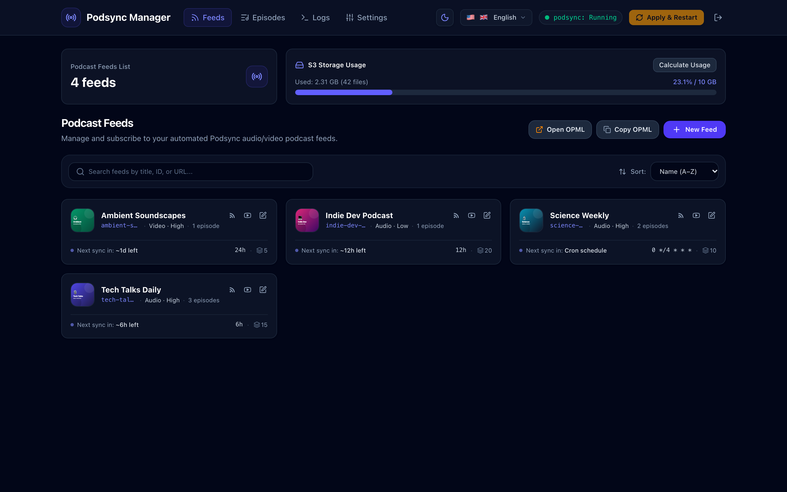
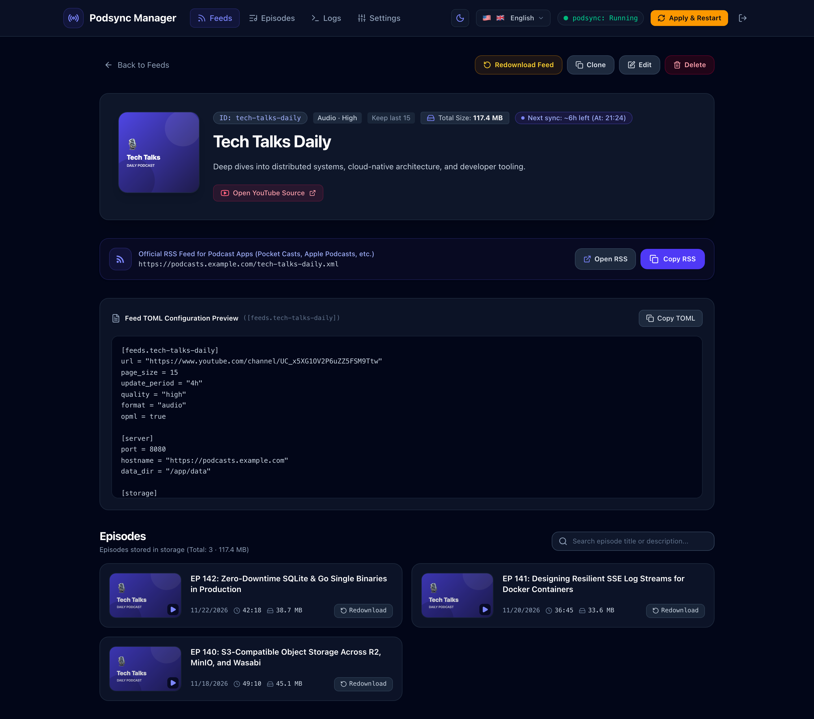
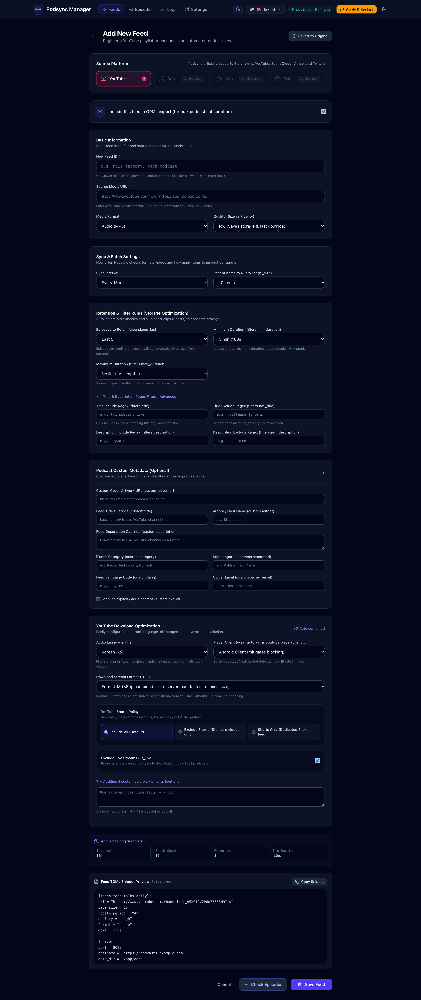
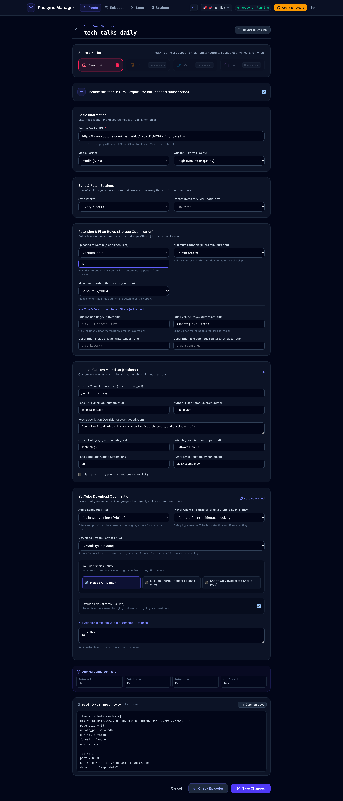
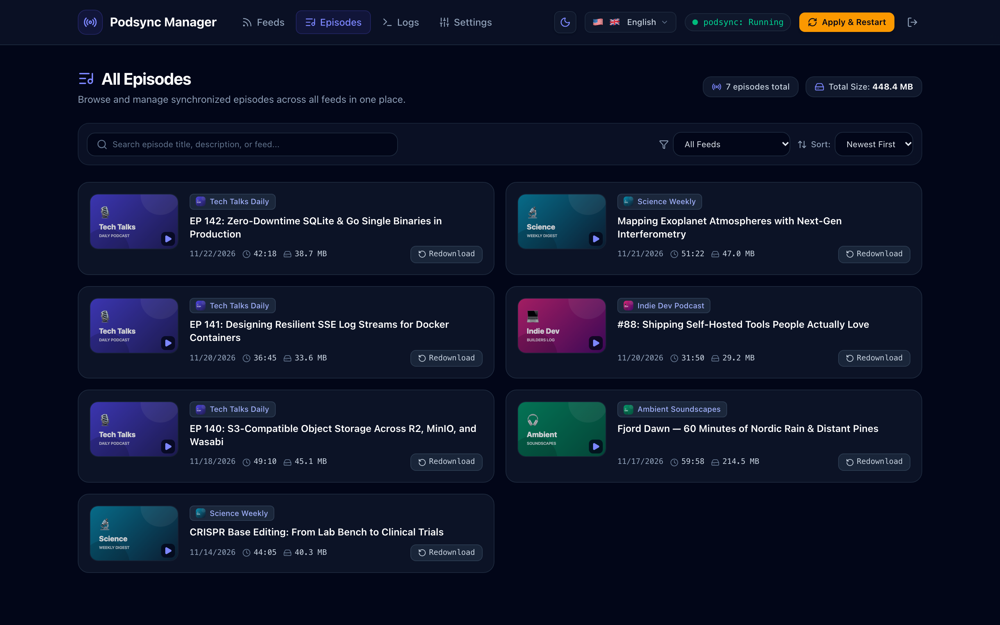
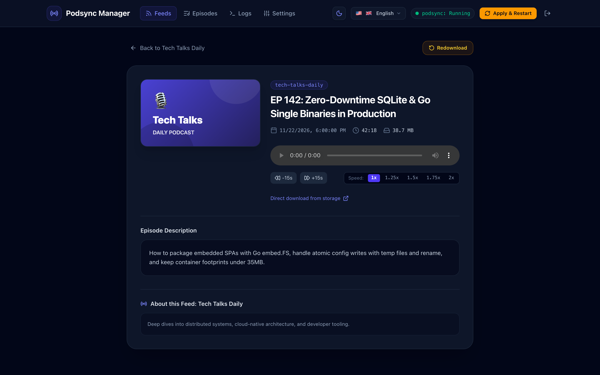
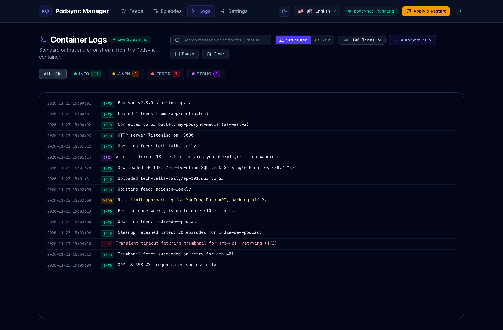
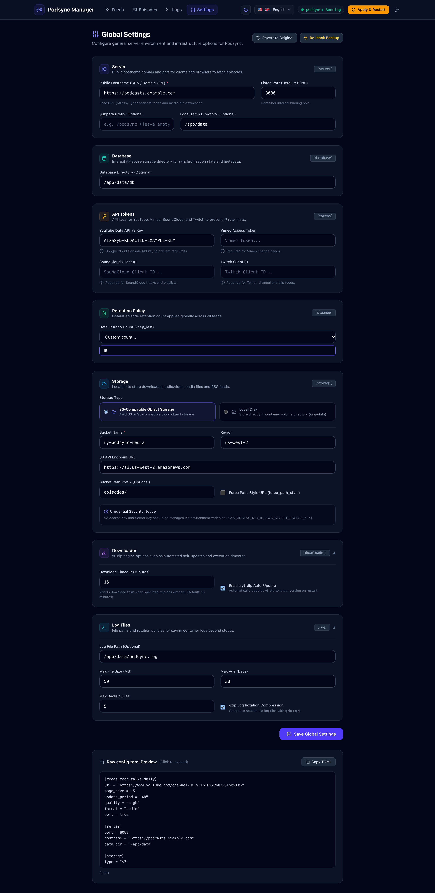
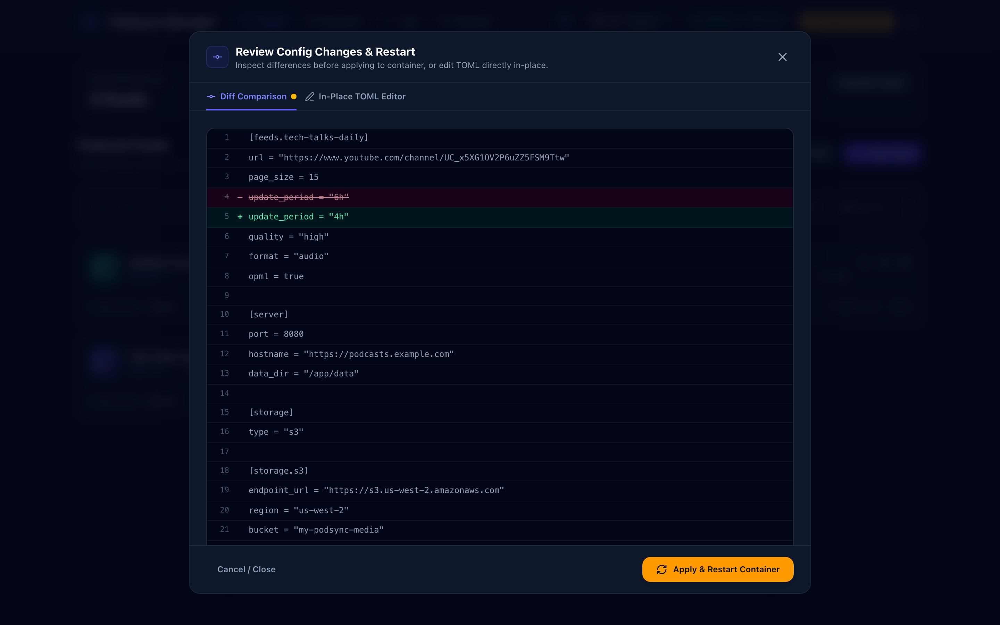
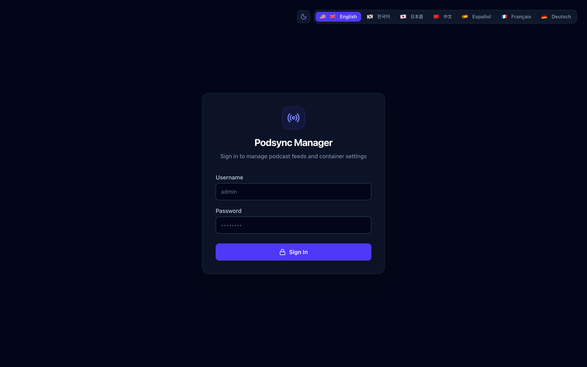

# Podsync Manager

> **Modern Web Dashboard & Container Manager for [Podsync](https://github.com/mxpv/podsync)**  
> *Crafted and built with [Google Antigravity](https://deepmind.google/technologies/gemini/).*

[](https://github.com/badugisoft/podsync-manager/releases/latest)
[](https://github.com/badugisoft/podsync-manager/releases)
[](https://go.dev/)
[](https://svelte.dev/)
[](https://github.com/badugisoft/podsync-manager/pkgs/container/podsync-manager)
[](LICENSE)
[](https://badugisoft.github.io/podsync-manager/)

<p align="center">
  <strong>English</strong> ·
  <a href="docs/README.ko.md">한국어</a> ·
  <a href="docs/README.ja.md">日本語</a> ·
  <a href="docs/README.zh.md">简体中文</a> ·
  <a href="docs/README.es.md">Español</a> ·
  <a href="docs/README.fr.md">Français</a> ·
  <a href="docs/README.de.md">Deutsch</a>
</p>

<p align="center">
  <a href="https://badugisoft.github.io/podsync-manager/"><strong>🌐 Project Website</strong></a> ·
  <a href="https://github.com/badugisoft/podsync-manager/releases/latest"><strong>📦 Latest Release</strong></a> ·
  <a href="#preview">Preview</a> ·
  <a href="#key-features">Features</a> ·
  <a href="#getting-started">Installation</a> ·
  <a href="#faq--troubleshooting">FAQ</a> ·
  <a href="#contributing">Contributing</a>
</p>

**Podsync Manager** is a lightweight, self-hosted Go + Svelte 5 web dashboard designed to manage and monitor [Podsync](https://github.com/mxpv/podsync) — a service that turns YouTube, Vimeo, SoundCloud, and Twitch channels or playlists into podcast feeds.

Without manually editing `config.toml`, you can manage feeds, inspect side-by-side TOML diffs before restarting containers, stream real-time SSE Docker logs, calculate S3 storage usage, and play audio episodes directly in your browser.

---

## Preview

  
*(All screenshots use mock data; sensitive credentials and private tokens are masked automatically for security.)*

<details>
<summary>📸 View All Page Screenshots (10 pages)</summary>

| Dashboard | Feed Detail |
| :---: | :---: |
|  |  |

| New Feed (All Sections Expanded) | Edit Feed (All Sections Expanded) |
| :---: | :---: |
|  |  |

| All Episodes | Episode Audio Player |
| :---: | :---: |
|  |  |

| Real-Time Container Logs | Global Settings (All Sections Expanded) |
| :---: | :---: |
|  |  |

| Config Diff & Apply Modal | Login |
| :---: | :---: |
|  |  |

</details>

---

## Key Features

### 1. Feed Lifecycle & YouTube Optimization
- **Intuitive Feed Form**: Create, edit, or clone podcast feeds from YouTube, Vimeo, SoundCloud, or Twitch URLs, and preview filter results before saving.
- **YouTube Presets**:
  - `format 18` (360p pre-merged single stream): Zero server CPU re-encoding, fast downloads, and minimal disk footprint.
  - Multi-language audio track priority (`-S lang:en/ko/ja`).
  - Android client emulation (`--extractor-args youtube:player-client=android`) to reduce bot detection and rate-limits.
  - Automatic exclusion of live streams (`!is_live`) and dedicated YouTube Shorts policies.
- **Retention & Filters**: `clean.keep_last`, `filters.min_duration` / `max_duration`, and regex title/description rules.
- **Atomic File Operations**: Temporary `.tmp` writes followed by atomic `rename`, with automatic `.bak` backups and one-click rollback.

### 2. Docker Container Control & Diff Review
- **Explicit Apply & Restart**: Saving configurations does not interrupt running services immediately; inspect changes first.
- **Side-by-Side Diff & In-Place TOML Editor**: Compare staged changes against the running container or edit raw TOML with syntax validation.
- **Real-Time Container Status**: Live container health monitoring (`Running`, `Stopped`, `Restarting`) via the Docker socket.

### 3. Real-Time SSE Log Streaming
- **Timestamp & Severity Badges**: Formatted `YYYY-MM-DD HH:mm:ss` logs with `INFO`, `WARN`, and `ERROR` tags.
- **Filtering & Views**: Level filters, keyword search, tail line selectors (100–1000 lines), auto-scroll lock, and Structured/Raw views.

### 4. S3-Compatible Cloud Storage & Web Audio Player
- **Vendor-Neutral Storage**: Works with AWS S3, Cloudflare R2, MinIO, Wasabi, and local disk volumes.
- **Auto Credential Detection**: Discovers S3 keys and endpoints directly from the running Podsync container environment.
- **In-Browser Audio Player**: Stream episodes with `1.0x–2.0x` playback speed controls and `±15s` skip buttons.
- **On-Demand Storage Calculation**: Queries bucket usage only when requested to avoid recurring API costs.

### 5. 7-Language Localization & Adaptive Themes
- **7 Supported Locales**: English, Korean, Japanese, Simplified Chinese, Spanish, French, and German with `localStorage` persistence.
- **Light / Dark / System Themes**: Zero-flicker theme initialization.

### 6. Self-Hosted Privacy & Security
- **100% Local Execution & Zero Telemetry**: Runs entirely in your own infrastructure; no analytics, tracking, or external telemetry are collected.
- **Protected Access**: HTTP-only session cookies (`ADMIN_USERNAME`, `ADMIN_PASSWORD`, `SESSION_SECRET`) and masked environment-injected credentials. See [SECURITY.md](SECURITY.md) for details.

---

## Getting Started

### Docker Compose (Recommended)

Add `podsync-manager` alongside `podsync` in your `docker-compose.yml`:

```yaml
services:
  podsync:
    image: mxpv/podsync:latest
    container_name: podsync
    restart: unless-stopped
    volumes:
      - ./config:/app/config
      - ./data:/app/data
    environment:
      - TZ=Asia/Seoul
      - AWS_ACCESS_KEY_ID=your_access_key_id
      - AWS_SECRET_ACCESS_KEY=your_secret_access_key

  podsync-manager:
    image: ghcr.io/badugisoft/podsync-manager:latest
    container_name: podsync-manager
    restart: unless-stopped
    ports:
      - "3000:3000"
    volumes:
      # Mount parent config folder (strongly recommended for atomic writes)
      - ./config:/app/config
      # Mount Docker socket for container control and SSE log streaming
      - /var/run/docker.sock:/var/run/docker.sock
    environment:
      - PODSYNC_CONFIG_PATH=/app/config/config.toml
      - PODSYNC_CONTAINER_NAME=podsync
      - PODSYNC_YOUTUBE_API_KEY=your_youtube_api_key_here
      - ADMIN_USERNAME=admin
      - ADMIN_PASSWORD=your_secure_password
      - SESSION_SECRET=generate_a_random_secret_string
      - AWS_ACCESS_KEY_ID=your_access_key_id
      - AWS_SECRET_ACCESS_KEY=your_secret_access_key
```

Run the stack:

```bash
docker compose up -d
```

### Docker Run CLI

```bash
docker run -d \
  --name podsync-manager \
  -p 3000:3000 \
  -v /var/run/docker.sock:/var/run/docker.sock \
  -v ./config:/app/config \
  -e ADMIN_PASSWORD=your_secure_password \
  ghcr.io/badugisoft/podsync-manager:latest
```

Access the dashboard at `http://localhost:3000`.

### Local Single-Binary Build

```bash
git clone https://github.com/badugisoft/podsync-manager.git
cd podsync-manager
cp .env.example .env
npm install && npm run build
go build -o podsync-manager ./cmd/server
./podsync-manager
```

---

## Environment Variables

| Variable | Description | Default |
| :--- | :--- | :--- |
| `PORT` | Web service port | `3000` |
| `PODSYNC_CONFIG_PATH` | Path to Podsync's `config.toml` | `config/config.toml` (`/app/config/config.toml` in container) |
| `PODSYNC_CONTAINER_NAME` | Name of the Podsync Docker container to manage | `podsync` |
| `PODSYNC_YOUTUBE_API_KEY` | YouTube Data API v3 Key for episode preview | `""` |
| `DOCKER_SOCKET` | Path to Docker unix socket | `/var/run/docker.sock` |
| `ADMIN_USERNAME` | Administrator username | `admin` |
| `ADMIN_PASSWORD` | Administrator password | *(Recommended to set)* |
| `SESSION_SECRET` | Secret key used to sign session cookies | *(Auto-generated if unset)* |
| `AWS_ACCESS_KEY_ID` | S3 / Cloudflare R2 access key | `""` |
| `AWS_SECRET_ACCESS_KEY` | S3 / Cloudflare R2 secret key | `""` |

---

## Repository Structure

```text
podsync-manager/
├── cmd/server/             # Go server entrypoint
├── internal/               # Go backend packages & embedded SPA dist
├── src/                    # Svelte 5 / SvelteKit frontend & 7-locale i18n
├── site/                   # Multi-language GitHub Pages landing site
├── assets/                 # Shared preview graphics & icons
├── docs/                   # Localized README.<lang>.md & architecture docs
├── .github/
│   ├── workflows/          # Docker GHCR publish & GitHub Pages deploy
│   ├── ISSUE_TEMPLATE/     # Bug report & feature request templates
│   └── PULL_REQUEST_TEMPLATE.md
├── CONTRIBUTING.md         # Contribution & build guide
├── SECURITY.md             # Security & privacy policy
├── LICENSE                 # MIT License
└── Dockerfile              # Multi-stage Alpine (~35MB) container build
```

---

## FAQ & Troubleshooting

<details>
<summary><strong>Why should I mount the ./config directory instead of config.toml directly?</strong></summary>

Mounting the parent directory (`-v ./config:/app/config`) allows Podsync Manager to write temporary `.tmp` files, perform atomic `rename` operations, and create `.bak` backups on the same host filesystem without `EXDEV` cross-device link errors or stale bind-mount inodes.
</details>

<details>
<summary><strong>Why does Podsync Manager need access to /var/run/docker.sock?</strong></summary>

Docker socket access is used strictly on your host to monitor container status, stream live SSE logs, restart the Podsync container after Diff review, and auto-detect S3 environment credentials configured on the Podsync container.
</details>

<details>
<summary><strong>How does the YouTube format 18 preset avoid CPU load and bot blocks?</strong></summary>

`format 18` downloads a pre-muxed 360p stream directly from YouTube without server-side `ffmpeg` re-encoding. Combined with Android client emulation (`--extractor-args youtube:player-client=android`), it speeds up downloads and helps avoid rate-limit blocks.
</details>

<details>
<summary><strong>How are S3 credentials and API keys protected?</strong></summary>

S3 keys and platform API tokens can be injected via environment variables and are masked in the web UI. Credentials are never sent outside your host and your configured S3 endpoint. See [SECURITY.md](SECURITY.md).
</details>

<details>
<summary><strong>Does Podsync Manager collect any telemetry?</strong></summary>

No. Podsync Manager is 100% self-hosted and collects zero telemetry, tracking, or usage analytics.
</details>

---

## Contributing

Contributions are welcome! Please read [CONTRIBUTING.md](CONTRIBUTING.md) before opening a pull request.

---

## License

This project is licensed under the MIT License — see the [LICENSE](LICENSE) file for details.  
Podsync is created and maintained by [mxpv](https://github.com/mxpv/podsync).
