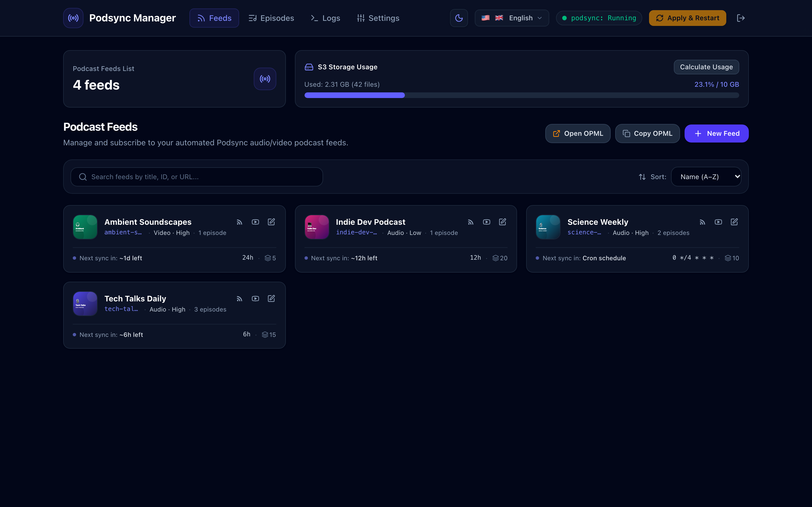
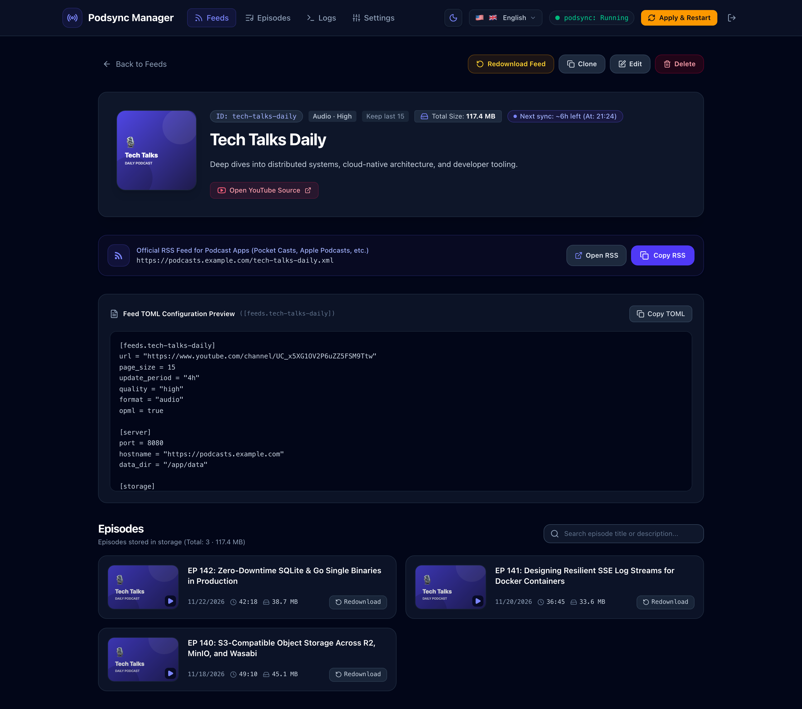
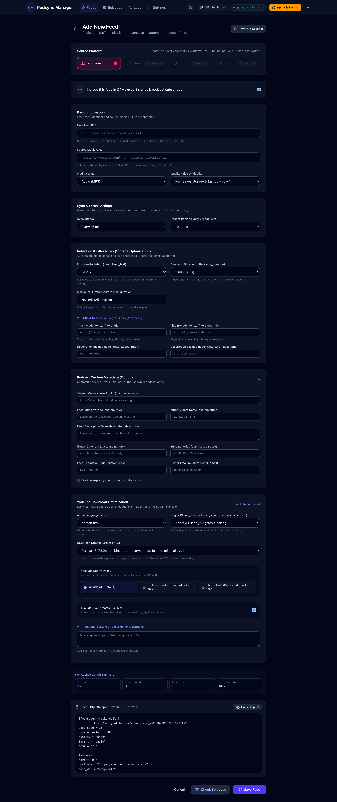
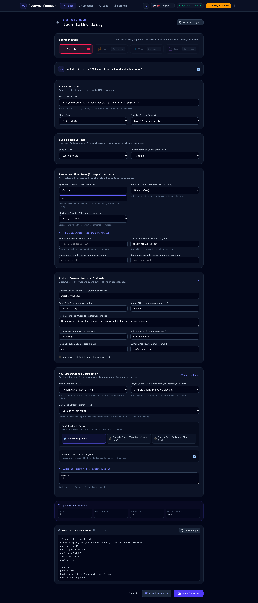
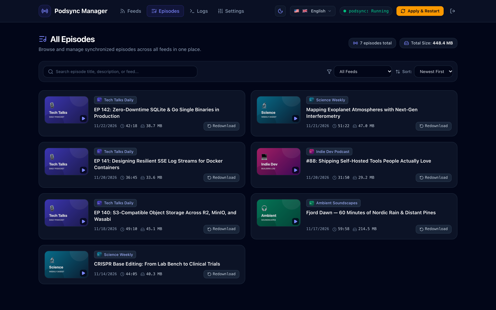
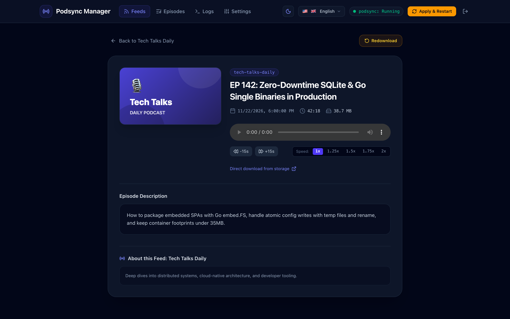
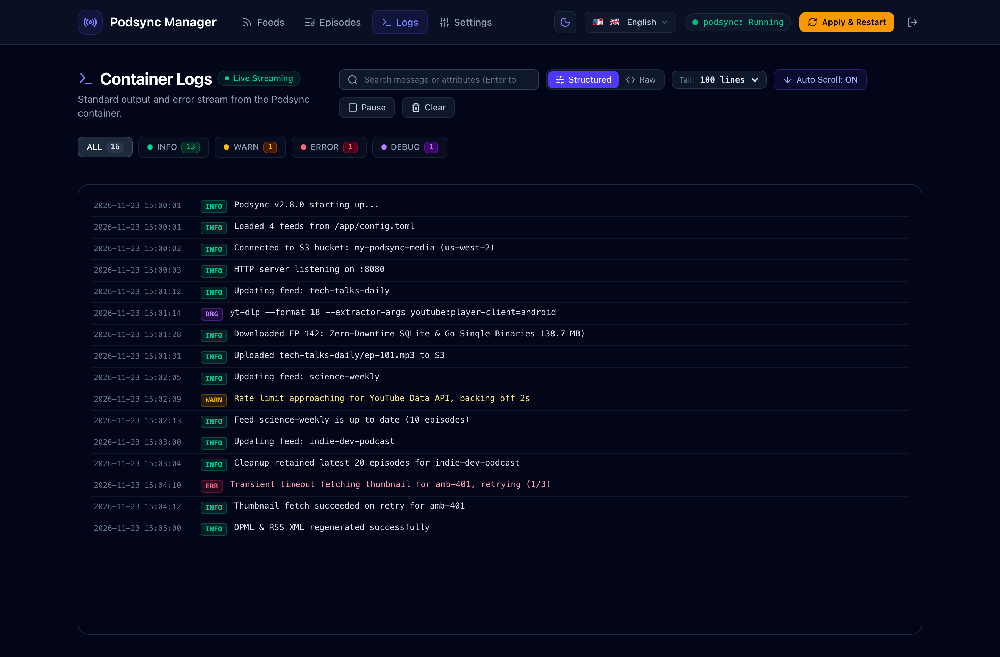
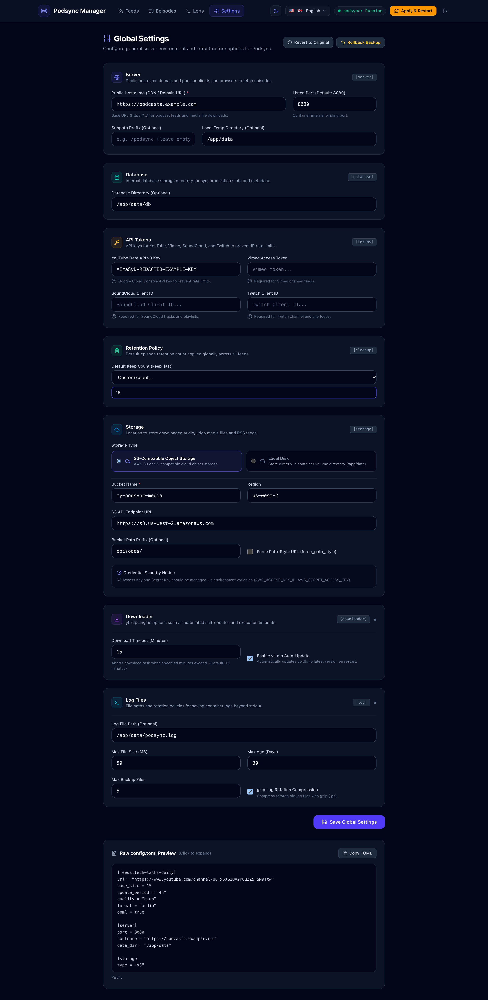
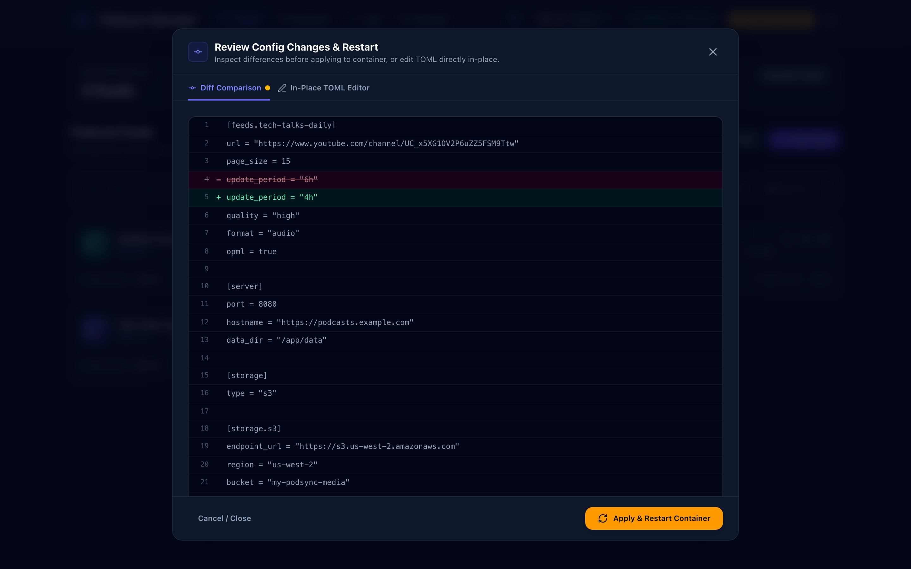
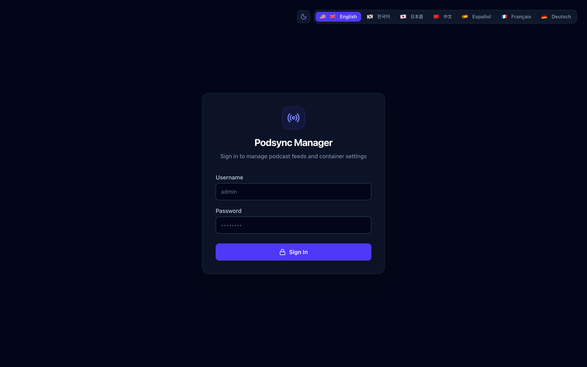

# Podsync Manager

> **Panel Web Moderno y Gestor de Contenedores para [Podsync](https://github.com/mxpv/podsync)**  
> *Diseñado y construido con [Google Antigravity](https://deepmind.google/technologies/gemini/).*

[](https://github.com/badugisoft/podsync-manager/releases/latest)
[](https://github.com/badugisoft/podsync-manager/releases)
[](https://go.dev/)
[](https://svelte.dev/)
[](https://github.com/badugisoft/podsync-manager/pkgs/container/podsync-manager)
[](../LICENSE)
[](https://badugisoft.github.io/podsync-manager/)

<p align="center">
  <a href="../README.md">English</a> ·
  <a href="README.ko.md">한국어</a> ·
  <a href="README.ja.md">日本語</a> ·
  <a href="README.zh.md">简体中文</a> ·
  <strong>Español</strong> ·
  <a href="README.fr.md">Français</a> ·
  <a href="README.de.md">Deutsch</a>
</p>

<p align="center">
  <a href="https://badugisoft.github.io/podsync-manager/?lang=es"><strong>🌐 Sitio del Proyecto</strong></a> ·
  <a href="https://github.com/badugisoft/podsync-manager/releases/latest"><strong>📦 Última Versión</strong></a> ·
  <a href="#vista-previa">Vista previa</a> ·
  <a href="#funciones-principales">Funciones</a> ·
  <a href="#primeros-pasos">Instalación</a> ·
  <a href="#faq-y-solución-de-problemas">FAQ</a> ·
  <a href="#contribuir">Contribuir</a>
</p>

**Podsync Manager** es un panel web ligero y autoalojado en Go + Svelte 5 diseñado para administrar y supervisar [Podsync](https://github.com/mxpv/podsync), un servicio que convierte canales y listas de YouTube, Vimeo, SoundCloud y Twitch en canales de podcast.

Sin editar manualmente `config.toml`, puedes gestionar canales, revisar diferencias TOML lado a lado antes de reiniciar el contenedor, ver registros Docker SSE en tiempo real, calcular el uso de almacenamiento S3 y reproducir episodios directamente en el navegador.

---

## Vista previa

  
*(Todas las capturas usan datos ficticios; las credenciales sensibles y los tokens privados se ocultan automáticamente.)*

<details>
<summary>📸 Ver capturas de todas las páginas (10 páginas)</summary>

| Panel | Detalle del feed |
| :---: | :---: |
|  |  |

| Nuevo feed (Todo expandido) | Editar feed (Todo expandido) |
| :---: | :---: |
|  |  |

| Todos los episodios | Reproductor de audio |
| :---: | :---: |
|  |  |

| Registros en tiempo real | Ajustes globales (Todo expandido) |
| :---: | :---: |
|  |  |

| Modal de Diff y reinicio | Iniciar sesión |
| :---: | :---: |
|  |  |

</details>

---

## Funciones principales

### 1. Ciclo de vida de canales y optimización para YouTube
- **Formulario intuitivo**: Crea, edita o clona canales desde URLs de YouTube, Vimeo, SoundCloud o Twitch y previsualiza el filtrado antes de guardar.
- **Preajustes de YouTube**:
  - `format 18` (flujo precombinado 360p): cero recodificación en CPU, descargas rápidas y mínimo tamaño.
  - Prioridad de idioma de audio (`-S lang:en/ko/ja`).
  - Emulación de cliente Android (`--extractor-args youtube:player-client=android`) para evitar detección de bots y límites de tasa.
  - Exclusión automática de transmisiones en vivo (`!is_live`) y políticas para YouTube Shorts.
- **Retención y filtros**: `clean.keep_last`, `filters.min_duration` / `max_duration` y expresiones regulares para título/descripción.
- **Escritura atómica**: Archivos temporales `.tmp` seguidos de `rename` atómico, copias `.bak` y restauración en un clic.

### 2. Control de Docker y revisión Diff
- **Aplicar y reiniciar explícito**: Guardar cambios no interrumpe el servicio; revisa las diferencias antes de reiniciar.
- **Comparación Diff y editor TOML directo**: Compara la configuración en curso con la pendiente o edita el TOML con validación de sintaxis.
- **Estado del contenedor en tiempo real**: Supervisión continua (`Activo`, `Detenido`, `Reiniciando`) mediante el socket Docker.

### 3. Registros SSE en tiempo real
- **Marcas de tiempo y severidad**: Formato `YYYY-MM-DD HH:mm:ss` con etiquetas `INFO`, `WARN` y `ERROR`.
- **Herramientas de filtrado**: Filtros por nivel, búsqueda por palabras clave, selector de líneas (100–1000) y vista Estructurada/Raw.

### 4. Almacenamiento S3 y reproductor web
- **Almacenamiento neutral**: Compatible con AWS S3, Cloudflare R2, MinIO, Wasabi y disco local.
- **Detección automática de credenciales**: Descubre claves y endpoints S3 desde el contenedor Podsync activo.
- **Reproductor de audio web**: Velocidad `1.0x–2.0x` y saltos de `±15s`.
- **Cálculo bajo demanda**: Consulta el tamaño del bucket solo al solicitarlo.

### 5. 7 idiomas y temas adaptativos
- **7 idiomas**: Inglés, coreano, japonés, chino simplificado, español, francés y alemán con persistencia en `localStorage`.
- **Tema Claro / Oscuro / Sistema**: Inicialización sin parpadeos.

### 6. Privacidad y seguridad autoalojada
- **100% local y sin telemetría**: Se ejecuta exclusivamente en tu infraestructura sin recopilar métricas externas.
- **Acceso protegido**: Cookies de sesión HTTP-only (`ADMIN_USERNAME`, `ADMIN_PASSWORD`, `SESSION_SECRET`) y credenciales enmascaradas. Consulta [SECURITY.md](../SECURITY.md).

---

## Primeros pasos

### Docker Compose (Recomendado)

```yaml
services:
  podsync:
    image: mxpv/podsync:latest
    container_name: podsync
    restart: unless-stopped
    volumes:
      - ./config:/app/config
      - ./data:/app/data
    environment:
      - TZ=Europe/Madrid
      - AWS_ACCESS_KEY_ID=your_access_key_id
      - AWS_SECRET_ACCESS_KEY=your_secret_access_key

  podsync-manager:
    image: ghcr.io/badugisoft/podsync-manager:latest
    container_name: podsync-manager
    restart: unless-stopped
    ports:
      - "3000:3000"
    volumes:
      - ./config:/app/config
      - /var/run/docker.sock:/var/run/docker.sock
    environment:
      - PODSYNC_CONFIG_PATH=/app/config/config.toml
      - PODSYNC_CONTAINER_NAME=podsync
      - PODSYNC_YOUTUBE_API_KEY=your_youtube_api_key_here
      - ADMIN_USERNAME=admin
      - ADMIN_PASSWORD=your_secure_password
      - SESSION_SECRET=generate_a_random_secret_string
      - AWS_ACCESS_KEY_ID=your_access_key_id
      - AWS_SECRET_ACCESS_KEY=your_secret_access_key
```

Ejecuta el stack:

```bash
docker compose up -d
```

### Docker Run CLI

```bash
docker run -d \
  --name podsync-manager \
  -p 3000:3000 \
  -v /var/run/docker.sock:/var/run/docker.sock \
  -v ./config:/app/config \
  -e ADMIN_PASSWORD=your_secure_password \
  ghcr.io/badugisoft/podsync-manager:latest
```

Accede en `http://localhost:3000`.

### Compilación local (Binario único)

```bash
git clone https://github.com/badugisoft/podsync-manager.git
cd podsync-manager
cp .env.example .env
npm install && npm run build
go build -o podsync-manager ./cmd/server
./podsync-manager
```

---

## Variables de entorno

| Variable | Descripción | Predeterminado |
| :--- | :--- | :--- |
| `PORT` | Puerto del servicio web | `3000` |
| `PODSYNC_CONFIG_PATH` | Ruta a `config.toml` de Podsync | `config/config.toml` (`/app/config/config.toml` en contenedor) |
| `PODSYNC_CONTAINER_NAME` | Nombre del contenedor Podsync | `podsync` |
| `PODSYNC_YOUTUBE_API_KEY` | Clave de YouTube Data API v3 | `""` |
| `DOCKER_SOCKET` | Ruta del socket Unix de Docker | `/var/run/docker.sock` |
| `ADMIN_USERNAME` | Usuario administrador | `admin` |
| `ADMIN_PASSWORD` | Contraseña de administrador | *(Recomendado configurar)* |
| `SESSION_SECRET` | Clave secreta para cookies de sesión | *(Autogenerada si no se define)* |
| `AWS_ACCESS_KEY_ID` | Clave de acceso S3 / Cloudflare R2 | `""` |
| `AWS_SECRET_ACCESS_KEY` | Clave secreta S3 / Cloudflare R2 | `""` |

---

## Estructura del repositorio

```text
podsync-manager/
├── cmd/server/             # Punto de entrada del servidor Go
├── internal/               # Paquetes Go y SPA incrustada (dist)
├── src/                    # Frontend Svelte 5 / SvelteKit e i18n (7 idiomas)
├── site/                   # Sitio promocional multilingüe para GitHub Pages
├── assets/                 # Gráficos de vista previa e iconos compartidos
├── docs/                   # README.<lang>.md localizados y documentación
├── .github/
│   ├── workflows/          # Publicación GHCR y despliegue en GitHub Pages
│   ├── ISSUE_TEMPLATE/     # Plantillas de errores y solicitudes
│   └── PULL_REQUEST_TEMPLATE.md
├── CONTRIBUTING.md         # Guía de contribución y compilación
├── SECURITY.md             # Política de seguridad y privacidad
├── LICENSE                 # Licencia MIT
└── Dockerfile              # Imagen Alpine multietapa (~35MB)
```

---

## FAQ y solución de problemas

<details>
<summary><strong>¿Por qué montar ./config en lugar de config.toml directamente?</strong></summary>

Montar el directorio padre (`-v ./config:/app/config`) permite escribir archivos temporales `.tmp`, realizar renombrados atómicos y crear respaldos `.bak` en el mismo sistema de archivos sin errores `EXDEV`.
</details>

<details>
<summary><strong>¿Por qué Podsync Manager necesita acceso a /var/run/docker.sock?</strong></summary>

Se utiliza únicamente en tu host para consultar el estado del contenedor, transmitir registros SSE en vivo, reiniciar Podsync tras revisar el Diff y detectar credenciales S3 automáticamente.
</details>

<details>
<summary><strong>¿Cómo evita el formato 18 de YouTube la carga de CPU y los bloqueos?</strong></summary>

`format 18` descarga un flujo 360p precombinado sin recodificación `ffmpeg` en el servidor. Combinado con la emulación Android, acelera las descargas y reduce bloqueos.
</details>

<details>
<summary><strong>¿Cómo se protegen las credenciales S3 y las claves de API?</strong></summary>

Pueden inyectarse mediante variables de entorno y se ocultan en la interfaz web. Nunca se envían fuera de tu host y el endpoint S3 configurado. Ver [SECURITY.md](../SECURITY.md).
</details>

<details>
<summary><strong>¿Recopila Podsync Manager alguna telemetría?</strong></summary>

No. Es 100% autoalojado y no recopila telemetría ni analíticas.
</details>

---

## Contribuir

¡Las contribuciones son bienvenidas! Lee [CONTRIBUTING.md](../CONTRIBUTING.md) antes de abrir un pull request.

---

## Licencia

Este proyecto está bajo la licencia MIT; consulta [LICENSE](../LICENSE).  
Podsync es creado y mantenido por [mxpv](https://github.com/mxpv/podsync).
