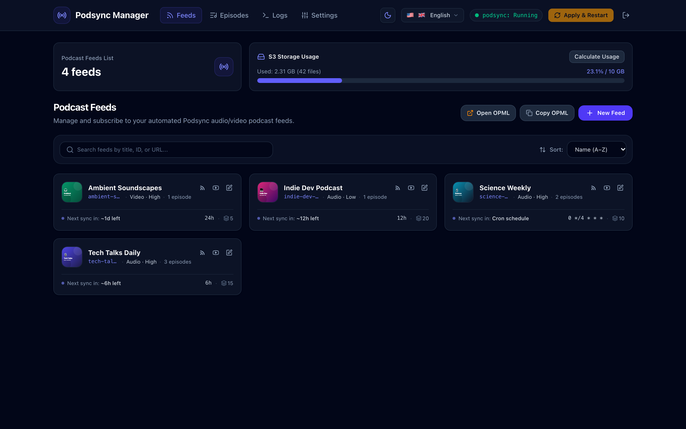
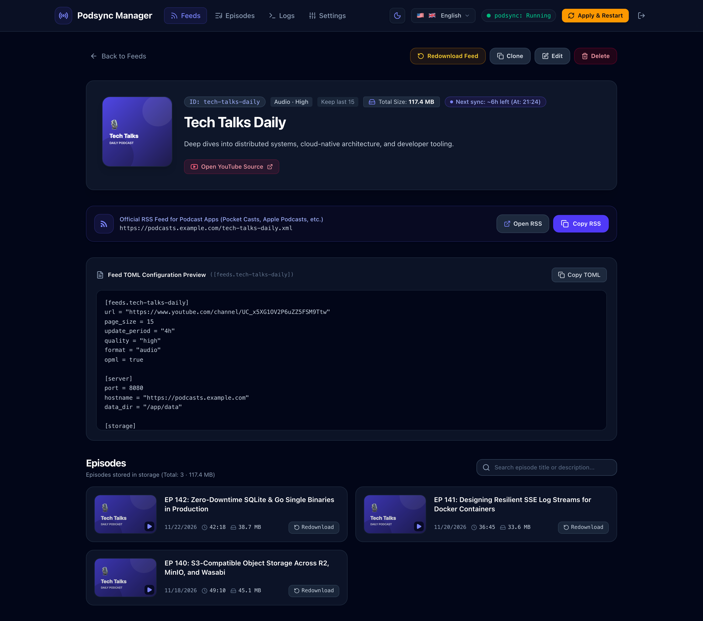
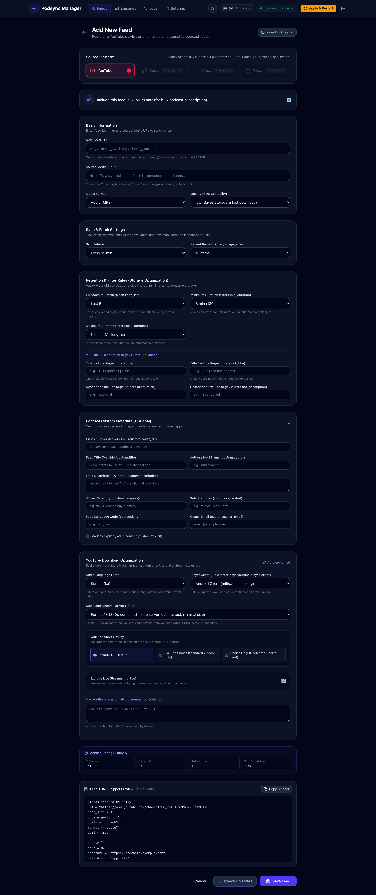
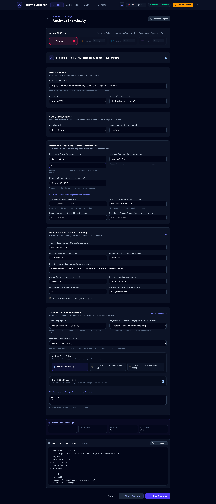
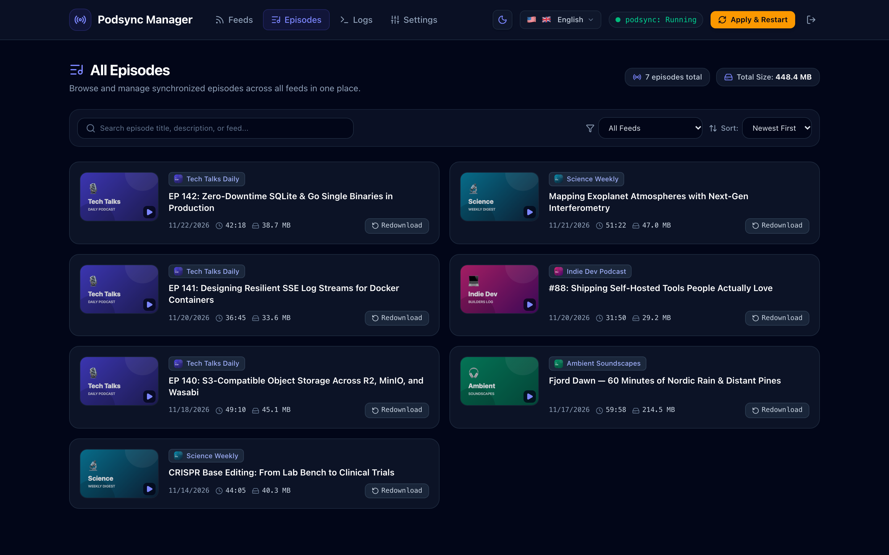
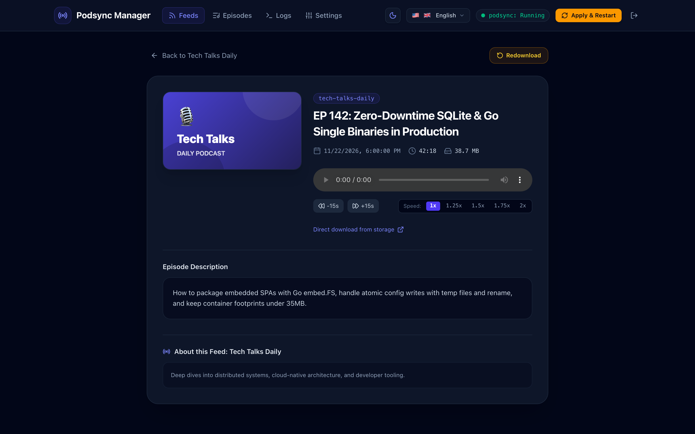
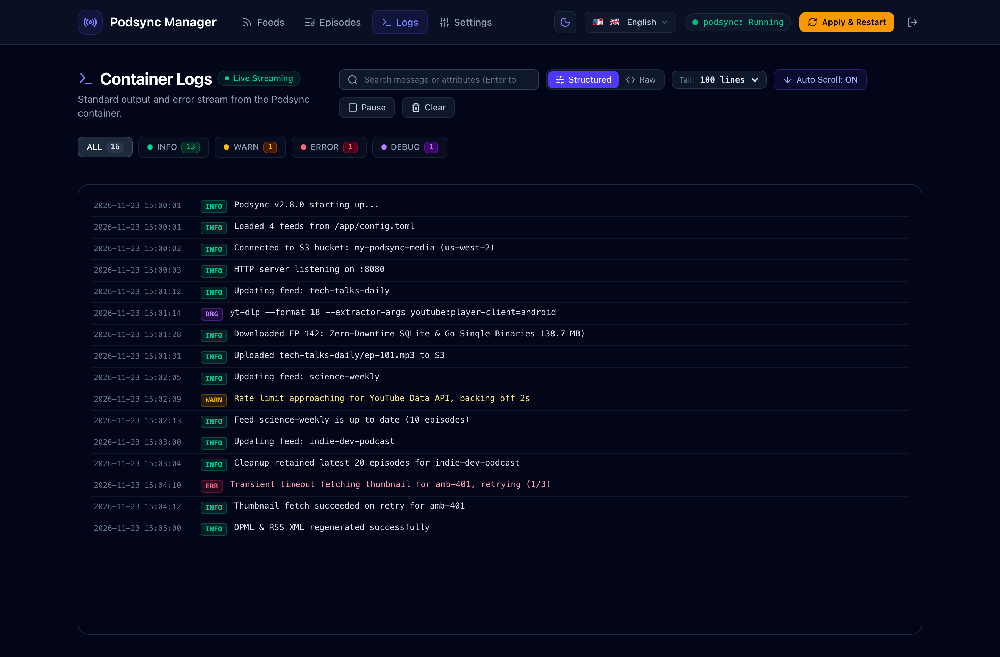
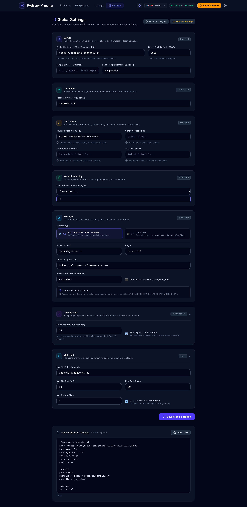
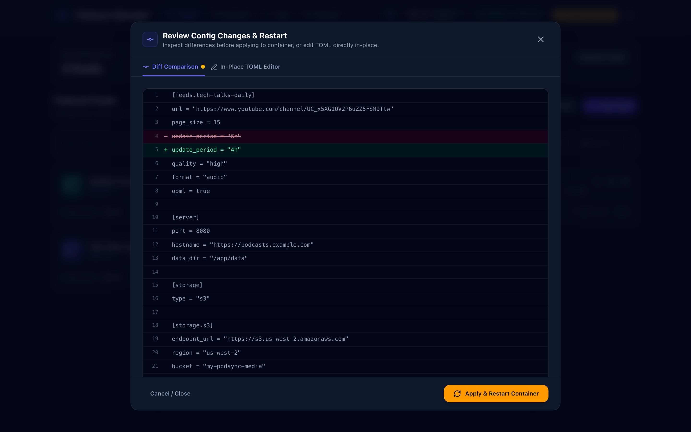
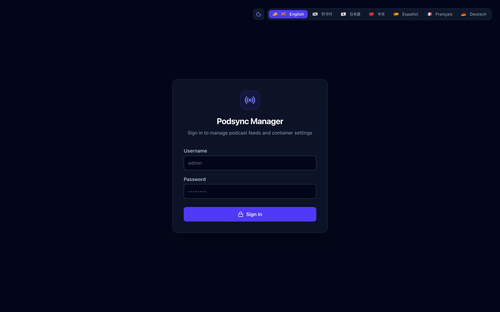

# Podsync Manager

> **[Podsync](https://github.com/mxpv/podsync)のためのモダンWebダッシュボード＆コンテナ管理ツール**  
> *[Google Antigravity](https://deepmind.google/technologies/gemini/)で設計・構築されました。*

[](https://github.com/badugisoft/podsync-manager/releases/latest)
[](https://github.com/badugisoft/podsync-manager/releases)
[](https://go.dev/)
[](https://svelte.dev/)
[](https://github.com/badugisoft/podsync-manager/pkgs/container/podsync-manager)
[](../LICENSE)
[](https://badugisoft.github.io/podsync-manager/)

<p align="center">
  <a href="../README.md">English</a> ·
  <a href="README.ko.md">한국어</a> ·
  <strong>日本語</strong> ·
  <a href="README.zh.md">简体中文</a> ·
  <a href="README.es.md">Español</a> ·
  <a href="README.fr.md">Français</a> ·
  <a href="README.de.md">Deutsch</a>
</p>

<p align="center">
  <a href="https://badugisoft.github.io/podsync-manager/?lang=ja"><strong>🌐 プロジェクトサイト</strong></a> ·
  <a href="https://github.com/badugisoft/podsync-manager/releases/latest"><strong>📦 最新リリース</strong></a> ·
  <a href="#プレビュー">プレビュー</a> ·
  <a href="#主な機能">主な機能</a> ·
  <a href="#はじめに">導入方法</a> ·
  <a href="#faqトラブルシューティング">FAQ</a> ·
  <a href="#コントリビュート">コントリビュート</a>
</p>

**Podsync Manager**は、YouTube・Vimeo・SoundCloud・Twitchのチャンネルや再生リストをポッドキャストフィードに変換する[Podsync](https://github.com/mxpv/podsync)を管理・監視するための、軽量なセルフホスト型Go + Svelte 5 Webダッシュボードです。

`config.toml`を手動編集することなく、Web UIからフィードを作成・編集し、コンテナ再起動前にTOMLの差分(Diff)を比較し、リアルタイムSSEログ配信、S3ストレージ使用量の計算、ブラウザ内での音声再生を行えます。

---

## プレビュー

  
*(すべてのスクリーンショットはモックデータを使用しており、機密認証情報およびプライベートトークンは自動的にマスクされます。)*

<details>
<summary>📸 全ページのスクリーンショットを見る (10ページ)</summary>

| ダッシュボード | フィード詳細 |
| :---: | :---: |
|  |  |

| 新規フィード作成 (全項目展開) | フィード編集 (全項目展開) |
| :---: | :---: |
|  |  |

| 全エピソード一覧 | エピソード再生プレーヤー |
| :---: | :---: |
|  |  |

| リアルタイムコンテナログ | グローバル設定 (全項目展開) |
| :---: | :---: |
|  |  |

| 設定差分 Diff ＆ 再起動モーダル | ログイン |
| :---: | :---: |
|  |  |

</details>

---

## 主な機能

### 1. フィード管理とYouTube最適化
- **直感的なフィードフォーム**: YouTube・Vimeo・SoundCloud・TwitchのURLからフィードを作成・編集・複製し、保存前にフィルター結果をシミュレーションできます。
- **YouTube最適化プリセット**:
  - `format 18`（360p結合済みストリーム）: サーバー側での再エンコード負荷ゼロ・高速ダウンロード・最小容量。
  - 多言語音声トラックの優先指定（`-S lang:en/ko/ja`）。
  - Androidクライアント偽装（`--extractor-args youtube:player-client=android`）によるBot検知およびレート制限の回避。
  - ライブ配信の自動除外（`!is_live`）およびYouTube Shortsポリシー設定。
- **保持・フィルタールール**: `clean.keep_last`、`filters.min_duration` / `max_duration`、正規表現によるタイトル・説明フィルター。
- **アトミックファイル操作**: 一時ファイル（`.tmp`）書き込み後のアトミックな`rename`、`.bak`自動バックアップ、ワンクリック復元に対応。

### 2. Dockerコンテナ制御とDiff比較
- **明示的な適用・再起動**: 設定を保存しても稼働中サービスを即座に中断せず、差分確認後に再起動を適用できます。
- **並列Diff比較＆インラインTOMLエディタ**: 稼働中の設定と変更内容の差分を確認し、構文検証付きで直接TOMLを編集できます。
- **リアルタイム状態監視**: Dockerソケット経由でコンテナの状態（`稼働中`、`停止中`、`再起動中`）をリアルタイム監視します。

### 3. リアルタイムSSEログストリーミング
- **タイムスタンプ＆重要度バッジ**: `YYYY-MM-DD HH:mm:ss`形式と`INFO`、`WARN`、`ERROR`タグを見やすく表示。
- **フィルタリング＆表示切替**: レベル別フィルター、キーワード検索、取得行数指定（100〜1000行）、自動スクロールロック、構造化/Rawテキスト表示に対応。

### 4. S3互換クラウドストレージとWebオーディオ再生
- **ベンダー中立ストレージ**: AWS S3、Cloudflare R2、MinIO、Wasabi、ローカルディスクボリュームに対応。
- **認証情報の自動検出**: 稼働中のPodsyncコンテナ環境変数からS3キーとエンドポイントを自動検出します。
- **ブラウザ内オーディオプレーヤー**: `1.0x〜2.0x`の再生速度調整および`±15秒`スキップ機能を搭載。
- **オンデマンド容量計算**: 定期的なAPI課金を防ぐため、ボタン押下時のみバケット使用量を集計します。

### 5. 7言語ローカライズ＆アダプティブテーマ
- **7言語対応**: 英語・日本語・韓国語・中国語（簡体字）・スペイン語・フランス語・ドイツ語と`localStorage`による設定保持。
- **ライト / ダーク / システムテーマ**: ちらつきのないテーマ初期化に対応。

### 6. セルフホストのプライバシーとセキュリティ
- **100%ローカル完結・テレメトリなし**: ユーザー自身のインフラ内でのみ動作し、利用統計やテレメトリは一切送信しません。
- **アクセス保護**: HTTP-OnlyセッションCookie（`ADMIN_USERNAME`、`ADMIN_PASSWORD`、`SESSION_SECRET`）と環境変数注入による認証情報保護を採用。詳細は[SECURITY.md](../SECURITY.md)を参照してください。

---

## はじめに

### Docker Compose（推奨）

`docker-compose.yml`に`podsync`と並べて`podsync-manager`を追加します：

```yaml
services:
  podsync:
    image: mxpv/podsync:latest
    container_name: podsync
    restart: unless-stopped
    volumes:
      - ./config:/app/config
      - ./data:/app/data
    environment:
      - TZ=Asia/Tokyo
      - AWS_ACCESS_KEY_ID=your_access_key_id
      - AWS_SECRET_ACCESS_KEY=your_secret_access_key

  podsync-manager:
    image: ghcr.io/badugisoft/podsync-manager:latest
    container_name: podsync-manager
    restart: unless-stopped
    ports:
      - "3000:3000"
    volumes:
      # アトミック保存のため親ディレクトリ(./config)のマウントを推奨
      - ./config:/app/config
      # コンテナ制御・SSEログ配信用Dockerソケット
      - /var/run/docker.sock:/var/run/docker.sock
    environment:
      - PODSYNC_CONFIG_PATH=/app/config/config.toml
      - PODSYNC_CONTAINER_NAME=podsync
      - PODSYNC_YOUTUBE_API_KEY=your_youtube_api_key_here
      - ADMIN_USERNAME=admin
      - ADMIN_PASSWORD=your_secure_password
      - SESSION_SECRET=generate_a_random_secret_string
      - AWS_ACCESS_KEY_ID=your_access_key_id
      - AWS_SECRET_ACCESS_KEY=your_secret_access_key
```

起動コマンド：

```bash
docker compose up -d
```

### Docker Run CLI

```bash
docker run -d \
  --name podsync-manager \
  -p 3000:3000 \
  -v /var/run/docker.sock:/var/run/docker.sock \
  -v ./config:/app/config \
  -e ADMIN_PASSWORD=your_secure_password \
  ghcr.io/badugisoft/podsync-manager:latest
```

ブラウザで`http://localhost:3000`にアクセスします。

### ローカル単一バイナリビルド

```bash
git clone https://github.com/badugisoft/podsync-manager.git
cd podsync-manager
cp .env.example .env
npm install && npm run build
go build -o podsync-manager ./cmd/server
./podsync-manager
```

---

## 環境変数

| 変数名 | 説明 | デフォルト |
| :--- | :--- | :--- |
| `PORT` | Webサービスポート | `3000` |
| `PODSYNC_CONFIG_PATH` | Podsyncの`config.toml`パス | `config/config.toml` (コンテナ内 `/app/config/config.toml`) |
| `PODSYNC_CONTAINER_NAME` | 管理対象のPodsyncコンテナ名 | `podsync` |
| `PODSYNC_YOUTUBE_API_KEY` | エピソードプレビュー用YouTube Data API v3キー | `""` |
| `DOCKER_SOCKET` | Docker Unixソケットパス | `/var/run/docker.sock` |
| `ADMIN_USERNAME` | 管理者ユーザー名 | `admin` |
| `ADMIN_PASSWORD` | 管理者パスワード | *(設定推奨)* |
| `SESSION_SECRET` | セッションCookie署名用シークレットキー | *(未設定時は自動生成)* |
| `AWS_ACCESS_KEY_ID` | S3 / Cloudflare R2アクセスキー | `""` |
| `AWS_SECRET_ACCESS_KEY` | S3 / Cloudflare R2シークレットキー | `""` |

---

## リポジトリ構成

```text
podsync-manager/
├── cmd/server/             # Goサーバーエントリーポイント
├── internal/               # Goバックエンドパッケージ＆埋め込みSPA dist
├── src/                    # Svelte 5 / SvelteKitフロントエンド＆7言語i18n
├── site/                   # 多言語GitHub Pagesランディングサイト
├── assets/                 # 共通プレビュー画像・アイコン
├── docs/                   # 多言語README.<lang>.mdおよび設計ドキュメント
├── .github/
│   ├── workflows/          # Docker GHCR公開＆GitHub Pagesデプロイ
│   ├── ISSUE_TEMPLATE/     # バグ報告・機能リクエストテンプレート
│   └── PULL_REQUEST_TEMPLATE.md
├── CONTRIBUTING.md         # コントリビュート＆ビルドガイド
├── SECURITY.md             # セキュリティ＆プライバシーポリシー
├── LICENSE                 # MITライセンス
└── Dockerfile              # マルチステージAlpine (~35MB) コンテナビルド
```

---

## FAQ・トラブルシューティング

<details>
<summary><strong>config.toml単体ではなく./configディレクトリのマウントが推奨される理由は？</strong></summary>

親ディレクトリ（`-v ./config:/app/config`）をマウントすることで、同一ホストファイルシステム上で`.tmp`一時ファイルの作成、アトミックな`rename`、`.bak`バックアップが`EXDEV`エラーやinode分離なしに安全に実行できます。
</details>

<details>
<summary><strong>Podsync Managerが/var/run/docker.sockへのアクセスを必要とする理由は？</strong></summary>

Dockerソケットはホスト上でコンテナ状態のリアルタイム確認、SSEライブログ配信、Diff確認後のコンテナ再起動、Podsyncコンテナ上のS3環境変数認証情報の自動検出にのみ使用されます。
</details>

<details>
<summary><strong>YouTubeフォーマット18プリセットはどのようにCPU負荷とBot検知を抑えますか？</strong></summary>

`format 18`はサーバー側で`ffmpeg`による再エンコードを行わず、YouTubeから結合済み360pストリームを直接ダウンロードします。Androidクライアント偽装（`--extractor-args youtube:player-client=android`）と併用することでダウンロードを高速化し、レート制限を回避します。
</details>

<details>
<summary><strong>S3認証情報やAPIキーはどのように保護されますか？</strong></summary>

S3キーや各プラットフォームのAPIトークンは環境変数で注入でき、Web UI上ではマスク表示されます。認証情報がホストと設定済みS3エンドポイント以外に送信されることはありません。詳細は[SECURITY.md](../SECURITY.md)をご覧ください。
</details>

<details>
<summary><strong>Podsync Managerはテレメトリを収集しますか？</strong></summary>

いいえ。Podsync Managerは100%セルフホスト型であり、テレメトリや追跡データは一切収集しません。
</details>

---

## コントリビュート

コントリビューションを歓迎します！Pull Requestを送る前に[CONTRIBUTING.md](../CONTRIBUTING.md)をご確認ください。

---

## ライセンス

本プロジェクトはMITライセンスのもとで公開されています。詳細は[LICENSE](../LICENSE)をご覧ください。  
Podsyncは[mxpv](https://github.com/mxpv/podsync)によって開発・保守されています。
