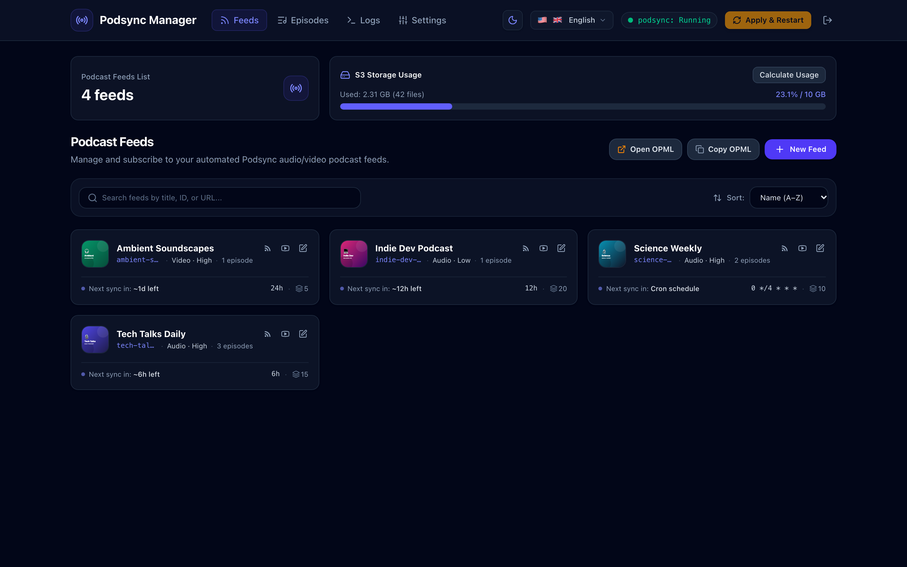
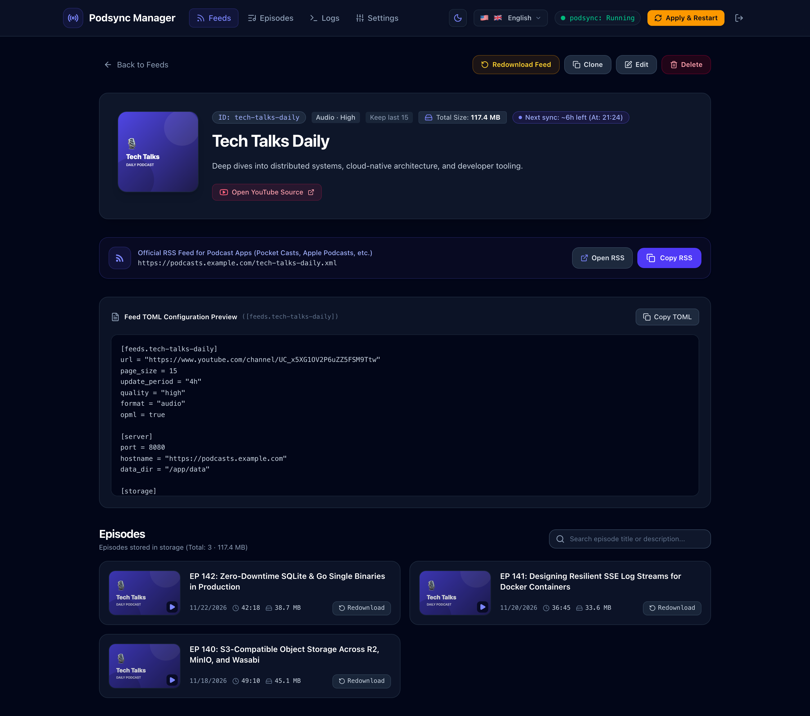
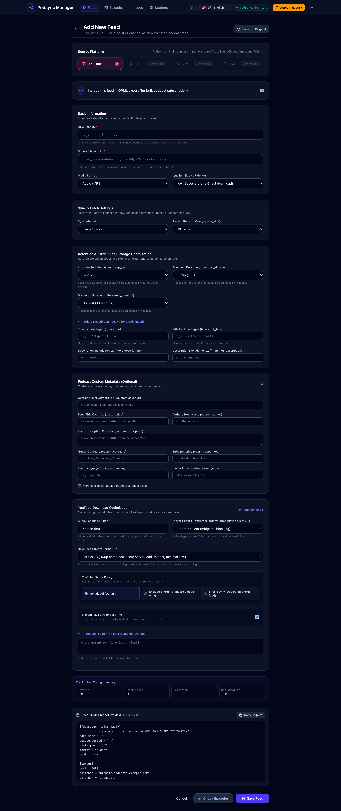
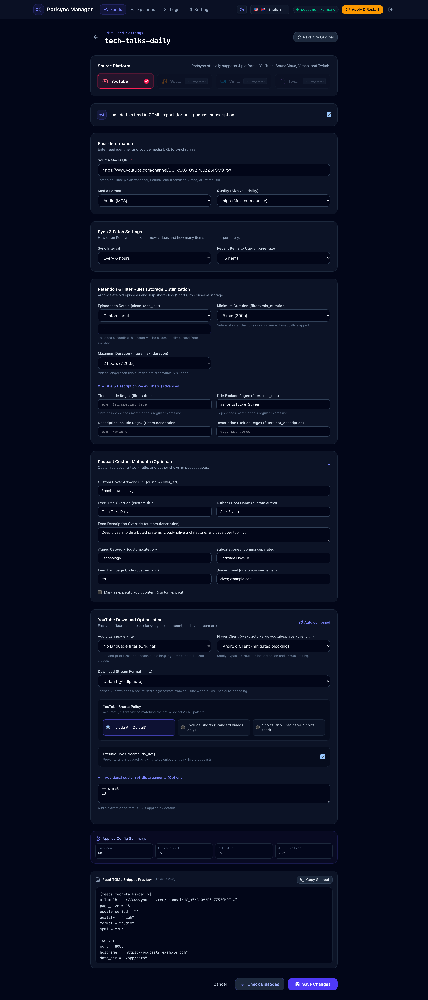
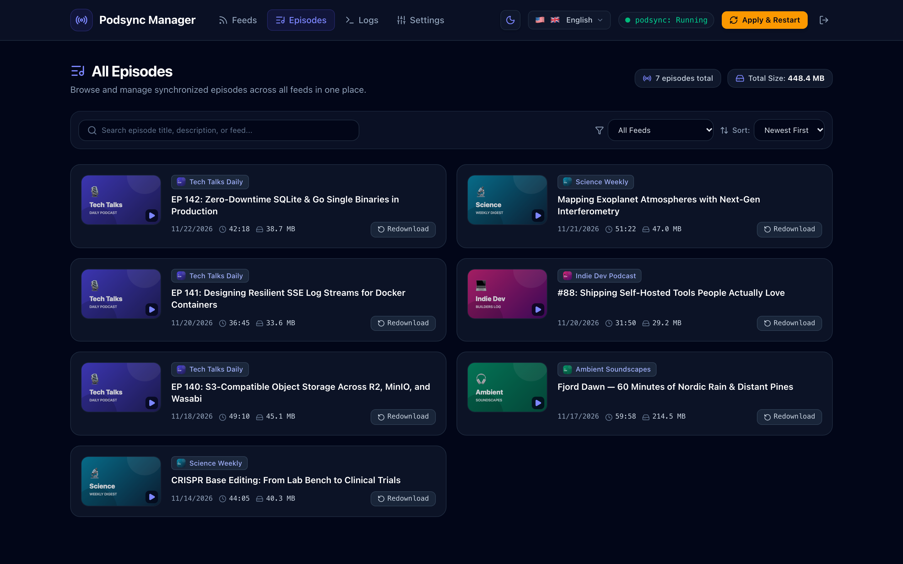
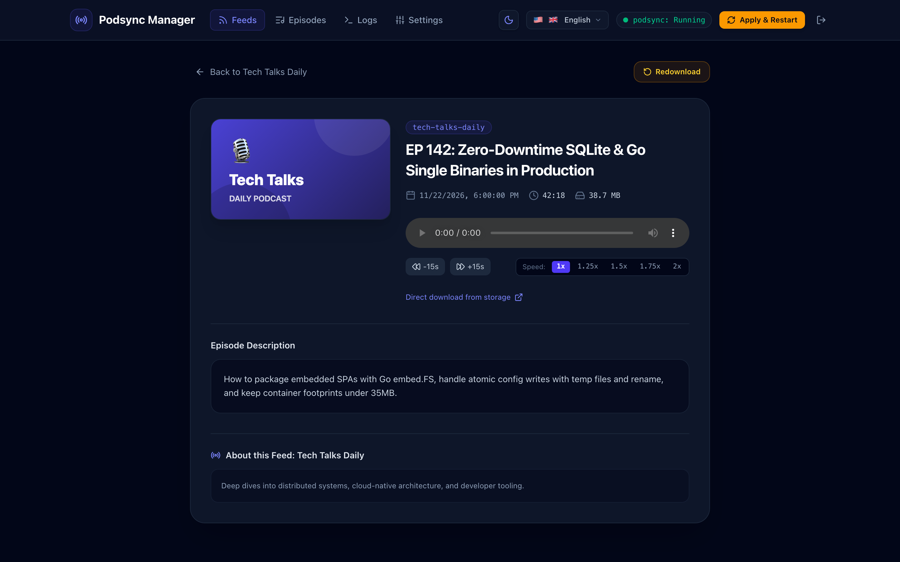
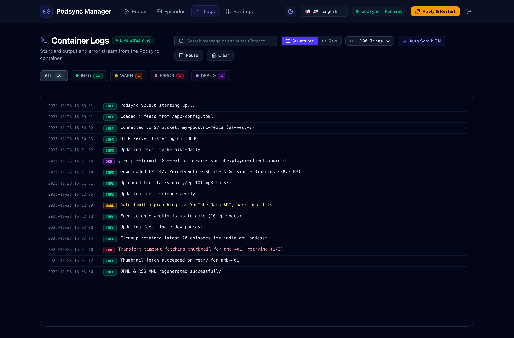
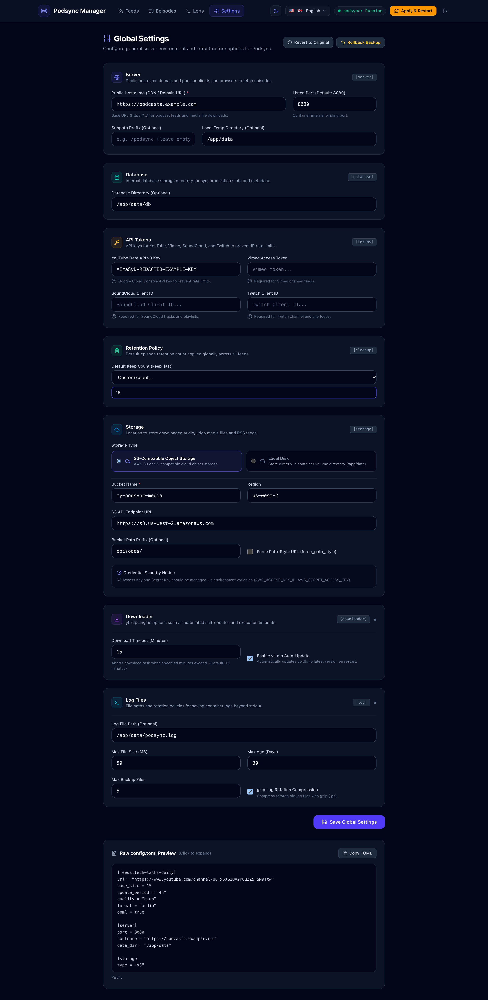
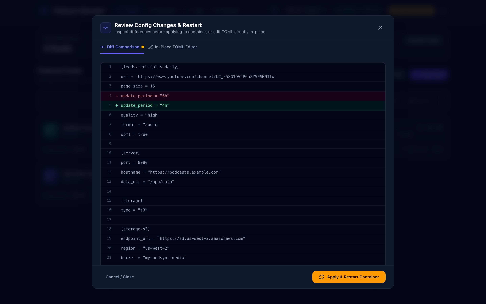
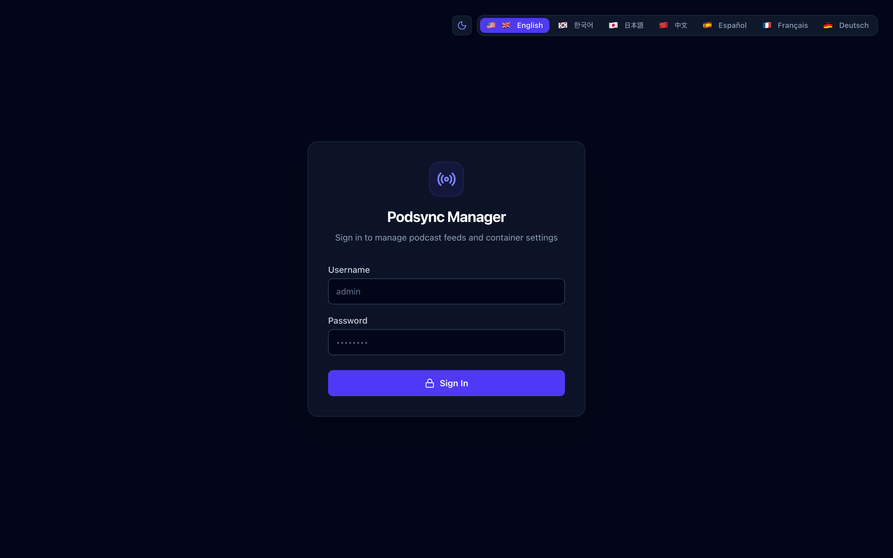

# Podsync Manager

> **[Podsync](https://github.com/mxpv/podsync)를 위한 모던 웹 대시보드 및 컨테이너 관리자**  
> *[Google Antigravity](https://deepmind.google/technologies/gemini/)로 설계 및 구축되었습니다.*

[](https://github.com/badugisoft/podsync-manager/releases/latest)
[](https://github.com/badugisoft/podsync-manager/releases)
[](https://go.dev/)
[](https://svelte.dev/)
[](https://github.com/badugisoft/podsync-manager/pkgs/container/podsync-manager)
[](../LICENSE)
[](https://badugisoft.github.io/podsync-manager/)

<p align="center">
  <a href="../README.md">English</a> ·
  <strong>한국어</strong> ·
  <a href="README.ja.md">日本語</a> ·
  <a href="README.zh.md">简体中文</a> ·
  <a href="README.es.md">Español</a> ·
  <a href="README.fr.md">Français</a> ·
  <a href="README.de.md">Deutsch</a>
</p>

<p align="center">
  <a href="https://badugisoft.github.io/podsync-manager/?lang=ko"><strong>🌐 프로젝트 웹사이트</strong></a> ·
  <a href="https://github.com/badugisoft/podsync-manager/releases/latest"><strong>📦 최신 릴리즈</strong></a> ·
  <a href="#미리보기">미리보기</a> ·
  <a href="#주요-기능">주요 기능</a> ·
  <a href="#시작하기">설치 방법</a> ·
  <a href="#faq-및-문제-해결">FAQ</a> ·
  <a href="#기여하기">기여하기</a>
</p>

**Podsync Manager**는 YouTube, Vimeo, SoundCloud, Twitch 채널 및 재생목록을 팟캐스트 피드로 변환해 주는 [Podsync](https://github.com/mxpv/podsync)를 관리하고 모니터링하기 위한 경량 셀프 호스팅 Go + Svelte 5 웹 대시보드입니다.

복잡한 `config.toml` 파일을 직접 편집하지 않고도 직관적인 웹 UI에서 피드를 등록·수정하고, 컨테이너 재시작 전 좌우 TOML Diff를 검토하며, 실시간 SSE 로그 스트리밍, S3 스토리지 용량 계산, 브라우저 내 오디오 재생을 한곳에서 처리할 수 있습니다.

---

## 미리보기

  
*(모든 스크린샷은 목업 데이터를 사용하여 촬영되었으며, 민감한 자격 증명 및 개인 토큰은 보안을 위해 자동 마스킹됩니다.)*

<details>
<summary>📸 전체 페이지 스크린샷 보기 (10개 페이지)</summary>

| 대시보드 | 피드 상세 |
| :---: | :---: |
|  |  |

| 새 피드 추가 (전체 펼침) | 피드 수정 (전체 펼침) |
| :---: | :---: |
|  |  |

| 전체 에피소드 | 에피소드 오디오 플레이어 |
| :---: | :---: |
|  |  |

| 실시간 컨테이너 로그 | 전역 설정 (전체 펼침) |
| :---: | :---: |
|  |  |

| 설정 변경 Diff 및 적용 모달 | 로그인 |
| :---: | :---: |
|  |  |

</details>

---

## 주요 기능

### 1. 피드 수명 주기 및 YouTube 최적화
- **직관적인 피드 등록/수정**: YouTube, Vimeo, SoundCloud, Twitch URL을 입력해 피드를 생성·수정·복제하고 저장 전 에피소드 필터 결과를 미리 검증할 수 있습니다.
- **YouTube 전용 프리셋**:
  - `format 18`(360p 결합 스트림): 서버 CPU 재인코딩 부하 0, 빠른 다운로드, 최소 용량.
  - 다국어 오디오 언어 우선순위 지정(`-S lang:en/ko/ja`).
  - Android 클라이언트 에뮬레이션(`--extractor-args youtube:player-client=android`)으로 봇 차단 및 속도 제한 완화.
  - 실시간 라이브 제외(`!is_live`) 및 YouTube Shorts 수집 정책 지원.
- **보관 및 필터 규칙**: `clean.keep_last`, `filters.min_duration` / `max_duration`, 제목·설명 정규식 필터링.
- **원자적 파일 저장**: `.tmp` 임시 파일 작성 후 원자적 `rename`, `.bak` 자동 백업 및 원클릭 복원 지원.

### 2. Docker 컨테이너 제어 및 Diff 검토
- **명시적 적용 · 재시작**: 설정 저장 시 실행 중인 서비스를 즉시 중단하지 않고 변경사항 검토 후 재시작합니다.
- **좌우 Diff 비교 및 인플레이스 TOML 편집**: 실행 중인 컨테이너 설정과 변경 내용을 비교하고 문법 검증이 포함된 편집기로 직접 수정할 수 있습니다.
- **실시간 컨테이너 상태 모니터링**: Docker 소켓을 통해 컨테이너 상태(`실행 중`, `중지됨`, `재시작 중`)를 실시간 확인합니다.

### 3. 실시간 SSE 로그 스트리밍
- **타임스탬프 및 심각도 배지**: `YYYY-MM-DD HH:mm:ss` 형식과 `INFO`, `WARN`, `ERROR` 배지를 제공합니다.
- **스마트 검색 및 보기 모드**: 레벨 필터, 키워드 검색, 가져올 줄 수 선택(100–1000줄), 자동 스크롤 잠금, 구조화/원문 보기를 지원합니다.

### 4. S3 호환 클라우드 스토리지 및 웹 오디오 플레이어
- **벤더 중립 스토리지**: AWS S3, Cloudflare R2, MinIO, Wasabi 및 로컬 디스크 볼륨을 모두 지원합니다.
- **컨테이너 자격 증명 자동 감지**: 실행 중인 Podsync 컨테이너 환경 변수에서 S3 키와 엔드포인트를 자동 탐색합니다.
- **브라우저 오디오 플레이어**: `1.0x–2.0x` 배속 조절 및 `±15초` 탐색 이동을 지원합니다.
- **온디맨드 스토리지 계산**: 불필요한 API 요금을 방지하기 위해 클릭 시에만 버킷 사용량을 집계합니다.

### 5. 7개 언어 다국어(i18n) 및 적응형 테마
- **7개 언어 지원**: 한국어, 영어, 일본어, 중국어(간체), 스페인어, 프랑스어, 독일어와 `localStorage` 상태 유지.
- **라이트 / 다크 / 시스템 테마**: 초기 렌더링 깜빡임 없는 테마 전환을 제공합니다.

### 6. 셀프 호스팅 프라이버시 및 보안
- **100% 로컬 실행 및 텔레메트리 없음**: 사용자 인프라 내에서만 동작하며 어떠한 사용 통계나 텔레메트리도 외부로 전송하지 않습니다.
- **접근 보호**: HTTP-Only 세션 쿠키(`ADMIN_USERNAME`, `ADMIN_PASSWORD`, `SESSION_SECRET`)와 마스킹된 자격 증명 관리를 제공합니다. 자세한 내용은 [SECURITY.md](../SECURITY.md)를 참고하세요.

---

## 시작하기

### Docker Compose (권장)

`docker-compose.yml`에 `podsync`와 함께 `podsync-manager`를 추가합니다:

```yaml
services:
  podsync:
    image: mxpv/podsync:latest
    container_name: podsync
    restart: unless-stopped
    volumes:
      - ./config:/app/config
      - ./data:/app/data
    environment:
      - TZ=Asia/Seoul
      - AWS_ACCESS_KEY_ID=your_access_key_id
      - AWS_SECRET_ACCESS_KEY=your_secret_access_key

  podsync-manager:
    image: ghcr.io/badugisoft/podsync-manager:latest
    container_name: podsync-manager
    restart: unless-stopped
    ports:
      - "3000:3000"
    volumes:
      # 원자적 파일 저장을 위해 상위 config 폴더 마운트 권장
      - ./config:/app/config
      # 컨테이너 제어 및 SSE 로그 스트리밍용 Docker 소켓
      - /var/run/docker.sock:/var/run/docker.sock
    environment:
      - PODSYNC_CONFIG_PATH=/app/config/config.toml
      - PODSYNC_CONTAINER_NAME=podsync
      - PODSYNC_YOUTUBE_API_KEY=your_youtube_api_key_here
      - ADMIN_USERNAME=admin
      - ADMIN_PASSWORD=your_secure_password
      - SESSION_SECRET=generate_a_random_secret_string
      - AWS_ACCESS_KEY_ID=your_access_key_id
      - AWS_SECRET_ACCESS_KEY=your_secret_access_key
```

스택 실행:

```bash
docker compose up -d
```

### Docker Run CLI

```bash
docker run -d \
  --name podsync-manager \
  -p 3000:3000 \
  -v /var/run/docker.sock:/var/run/docker.sock \
  -v ./config:/app/config \
  -e ADMIN_PASSWORD=your_secure_password \
  ghcr.io/badugisoft/podsync-manager:latest
```

브라우저에서 `http://localhost:3000`으로 접속합니다.

### 로컬 단일 바이너리 빌드

```bash
git clone https://github.com/badugisoft/podsync-manager.git
cd podsync-manager
cp .env.example .env
npm install && npm run build
go build -o podsync-manager ./cmd/server
./podsync-manager
```

---

## 환경 변수

| 변수명 | 설명 | 기본값 |
| :--- | :--- | :--- |
| `PORT` | 웹 서비스 포트 | `3000` |
| `PODSYNC_CONFIG_PATH` | Podsync `config.toml` 경로 | `config/config.toml` (컨테이너 내 `/app/config/config.toml`) |
| `PODSYNC_CONTAINER_NAME` | 관리할 Podsync Docker 컨테이너 이름 | `podsync` |
| `PODSYNC_YOUTUBE_API_KEY` | 에피소드 미리보기용 YouTube Data API v3 키 | `""` |
| `DOCKER_SOCKET` | Docker 유닉스 소켓 경로 | `/var/run/docker.sock` |
| `ADMIN_USERNAME` | 관리자 아이디 | `admin` |
| `ADMIN_PASSWORD` | 관리자 비밀번호 | *(설정 권장)* |
| `SESSION_SECRET` | 세션 쿠키 서명 키 | *(미설정 시 자동 생성)* |
| `AWS_ACCESS_KEY_ID` | S3 / Cloudflare R2 액세스 키 | `""` |
| `AWS_SECRET_ACCESS_KEY` | S3 / Cloudflare R2 시크릿 키 | `""` |

---

## 저장소 구조

```text
podsync-manager/
├── cmd/server/             # Go 서버 진입점
├── internal/               # Go 백엔드 패키지 및 임베딩된 SPA dist
├── src/                    # Svelte 5 / SvelteKit 프론트엔드 및 7개 언어 i18n
├── site/                   # 다국어 GitHub Pages 랜딩 페이지
├── assets/                 # 공용 미리보기 이미지 및 아이콘
├── docs/                   # 다국어 README.<lang>.md 및 아키텍처 문서
├── .github/
│   ├── workflows/          # Docker GHCR 배포 및 GitHub Pages 워크플로우
│   ├── ISSUE_TEMPLATE/     # 버그 제보 및 기능 요청 템플릿
│   └── PULL_REQUEST_TEMPLATE.md
├── CONTRIBUTING.md         # 기여 및 빌드 가이드
├── SECURITY.md             # 보안 및 프라이버시 정책
├── LICENSE                 # MIT 라이선스
└── Dockerfile              # 멀티 스테이지 Alpine(~35MB) 컨테이너 빌드
```

---

## FAQ 및 문제 해결

<details>
<summary><strong>config.toml 단일 파일 대신 ./config 디렉터리 마운트를 권장하는 이유는 무엇인가요?</strong></summary>

상위 디렉터리(`-v ./config:/app/config`)를 마운트해야 동일 호스트 파일시스템에서 `.tmp` 임시 파일 생성, 원자적 `rename`, `.bak` 백업이 `EXDEV` 교차 장치 오류나 아이노드 분리 없이 정상 동작합니다.
</details>

<details>
<summary><strong>Podsync Manager가 /var/run/docker.sock 접근 권한을 필요로 하는 이유는 무엇인가요?</strong></summary>

컨테이너 상태 실시간 조회, SSE 실시간 로그 스트리밍, Diff 검토 후 컨테이너 재시작, 그리고 Podsync 컨테이너에 설정된 S3 자격 증명 자동 감지를 위해 호스트의 Docker 소켓을 사용합니다.
</details>

<details>
<summary><strong>YouTube 포맷 18 프리셋은 어떻게 CPU 부하와 봇 차단을 줄이나요?</strong></summary>

`format 18`은 서버 측 `ffmpeg` 재인코딩 없이 유튜브에서 미리 결합된 360p 단일 스트림을 받아오므로 CPU 소모가 거의 없으며, Android 클라이언트 에뮬레이션(`--extractor-args youtube:player-client=android`)과 함께 속도 제한 및 봇 차단을 완화합니다.
</details>

<details>
<summary><strong>S3 자격 증명과 API 키는 어떻게 보호되나요?</strong></summary>

S3 키와 플랫폼 API 토큰은 환경 변수로 주입할 수 있으며 웹 UI에서 자동 마스킹됩니다. 자격 증명은 호스트 및 설정된 S3 엔드포인트 외부로 전송되지 않습니다. 자세한 내용은 [SECURITY.md](../SECURITY.md)를 참고하세요.
</details>

<details>
<summary><strong>Podsync Manager는 텔레메트리를 수집하나요?</strong></summary>

아니요. Podsync Manager는 100% 셀프 호스팅 도구이며 어떠한 텔레메트리, 추적, 사용 통계도 수집하지 않습니다.
</details>

---

## 기여하기

기여를 환영합니다! Pull Request를 보내기 전에 [CONTRIBUTING.md](../CONTRIBUTING.md)를 확인해 주세요.

---

## 라이선스

이 프로젝트는 MIT 라이선스를 따릅니다. 자세한 내용은 [LICENSE](../LICENSE) 파일을 참고하세요.  
Podsync는 [mxpv](https://github.com/mxpv/podsync)가 개발 및 유지보수합니다.
