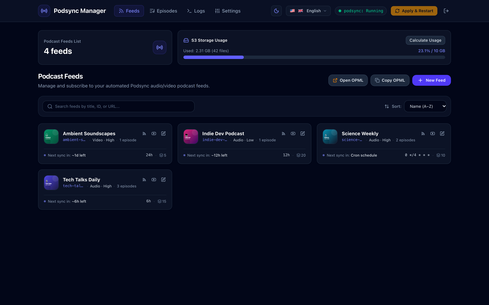
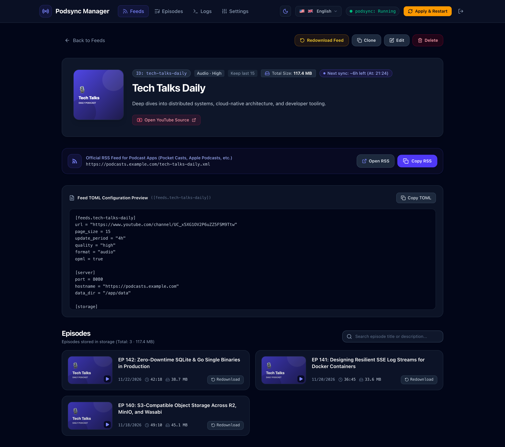
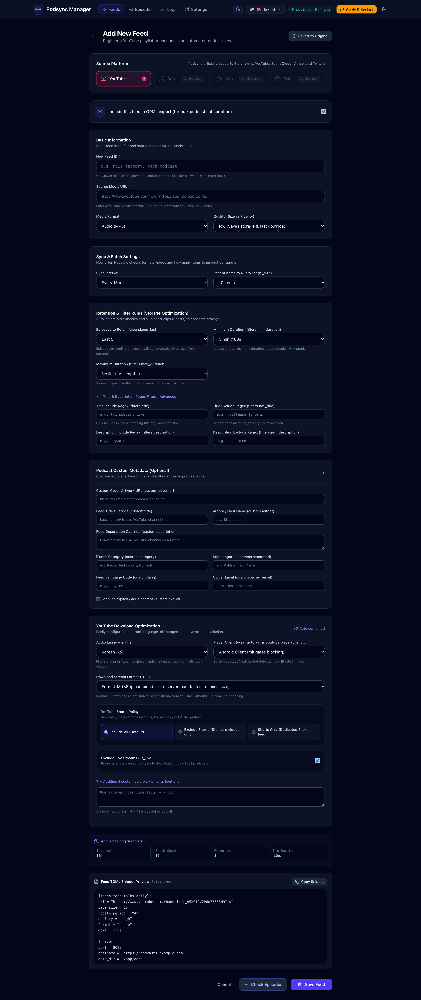
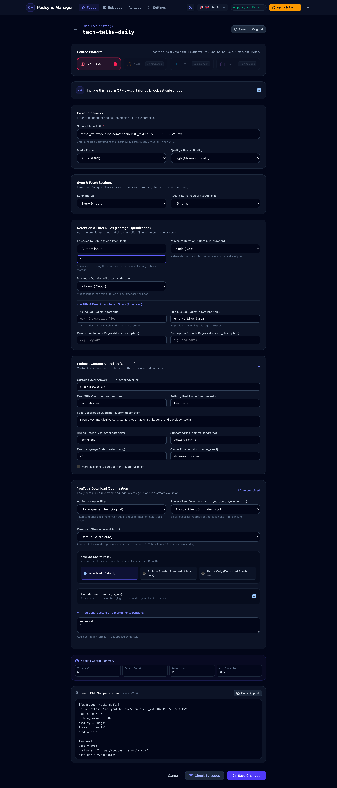
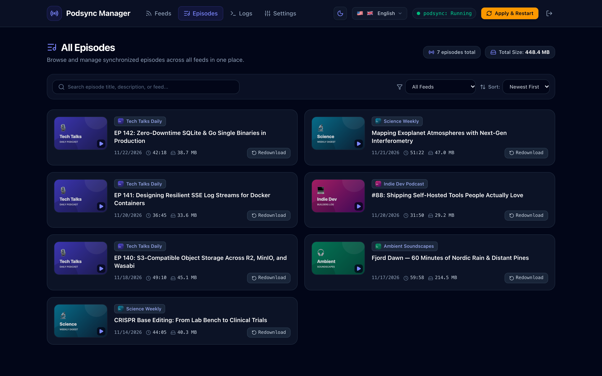
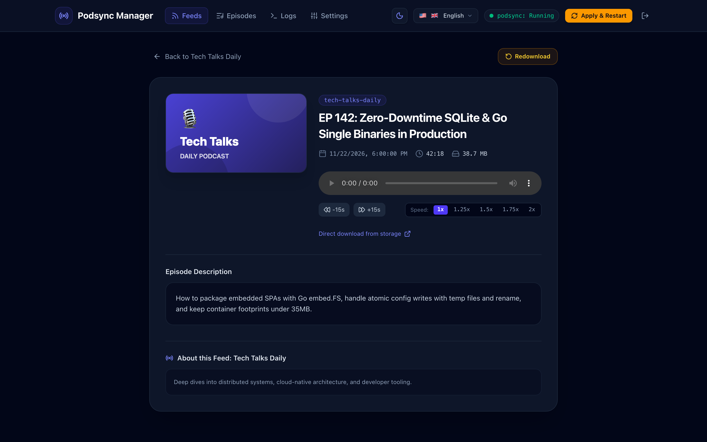
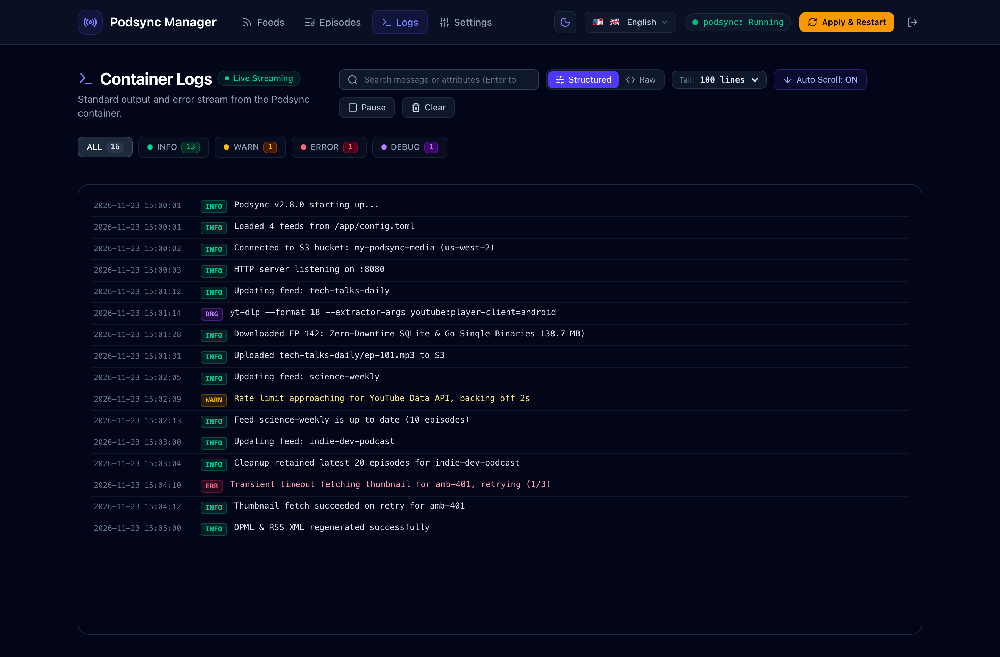
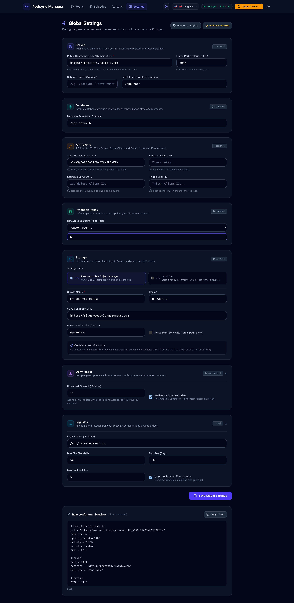
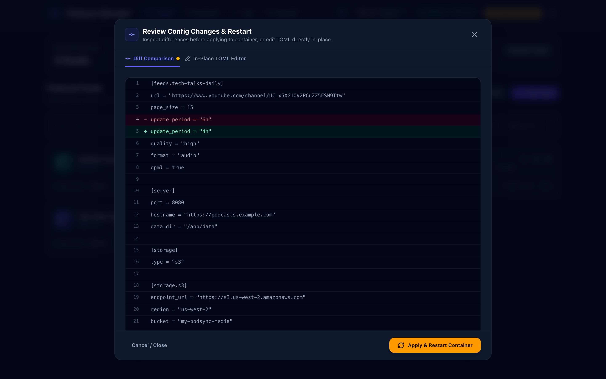
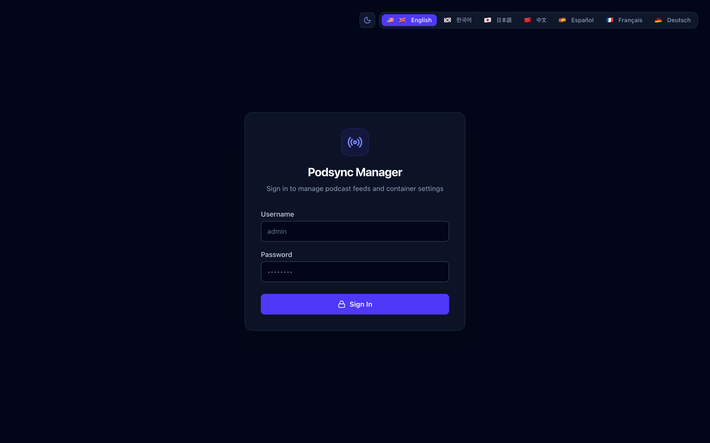

# Podsync Manager

> **适用于 [Podsync](https://github.com/mxpv/podsync) 的现代 Web 仪表盘与容器管理器**  
> *使用 [Google Antigravity](https://deepmind.google/technologies/gemini/) 设计与构建。*

[](https://github.com/badugisoft/podsync-manager/releases/latest)
[](https://github.com/badugisoft/podsync-manager/releases)
[](https://go.dev/)
[](https://svelte.dev/)
[](https://github.com/badugisoft/podsync-manager/pkgs/container/podsync-manager)
[](../LICENSE)
[](https://badugisoft.github.io/podsync-manager/)

<p align="center">
  <a href="../README.md">English</a> ·
  <a href="README.ko.md">한국어</a> ·
  <a href="README.ja.md">日本語</a> ·
  <strong>简体中文</strong> ·
  <a href="README.es.md">Español</a> ·
  <a href="README.fr.md">Français</a> ·
  <a href="README.de.md">Deutsch</a>
</p>

<p align="center">
  <a href="https://badugisoft.github.io/podsync-manager/?lang=zh"><strong>🌐 项目官网</strong></a> ·
  <a href="https://github.com/badugisoft/podsync-manager/releases/latest"><strong>📦 最新版本</strong></a> ·
  <a href="#界面预览">预览</a> ·
  <a href="#核心功能">核心功能</a> ·
  <a href="#快速开始">安装</a> ·
  <a href="#常见问题与排查">FAQ</a> ·
  <a href="#参与贡献">贡献</a>
</p>

**Podsync Manager** 是一款轻量级、自托管的 Go + Svelte 5 Web 仪表盘，用于管理和监控 [Podsync](https://github.com/mxpv/podsync)——将 YouTube、Vimeo、SoundCloud 和 Twitch 频道或播放列表转换为播客订阅源的服务。

无需手动编辑复杂的 `config.toml` 文件，即可通过网页界面管理订阅源、在重启容器前并排审查 TOML 差异（Diff）、查看实时 SSE Docker 日志流、统计 S3 存储用量，并在浏览器中直接播放音频单集。

---

## 界面预览

  
*(所有截图均使用模拟数据拍摄，敏感凭据与私有令牌会自动脱敏隐藏。)*

<details>
<summary>📸 查看全部页面截图 (10 个页面)</summary>

| 仪表盘 | 订阅源详情 |
| :---: | :---: |
|  |  |

| 新建订阅源 (全部展开) | 编辑订阅源 (全部展开) |
| :---: | :---: |
|  |  |

| 全部剧集 | 剧集音频播放器 |
| :---: | :---: |
|  |  |

| 实时容器日志 | 全局设置 (全部展开) |
| :---: | :---: |
|  |  |

| 配置差异 Diff 与重启弹窗 | 登录 |
| :---: | :---: |
|  |  |

</details>

---

## 核心功能

### 1. 订阅生命周期与 YouTube 优化
- **直观的订阅表单**：通过 YouTube、Vimeo、SoundCloud 或 Twitch 链接创建、编辑或克隆播客订阅，并在保存前预览过滤效果。
- **YouTube 优化预设**：
  - `format 18`（360p 预混流单文件）：服务器 CPU 零转码负载、极速下载、占用空间最小。
  - 多语言音轨优先级（`-S lang:en/ko/ja`）。
  - Android 客户端模拟（`--extractor-args youtube:player-client=android`），有效规避机器人检测与速率限制。
  - 自动排除直播流（`!is_live`）并支持 YouTube Shorts 专属过滤策略。
- **保留与过滤规则**：支持 `clean.keep_last`、`filters.min_duration` / `max_duration` 以及标题/描述正则过滤。
- **原子文件写入**：先写入 `.tmp` 临时文件再原子 `rename`，附带 `.bak` 自动备份与一键回滚。

### 2. Docker 容器控制与 Diff 审查
- **显式应用并重启**：保存配置不会立即中断运行中的服务，审查差异后再手动触发重启。
- **并排 Diff 与就地 TOML 编辑器**：对比当前运行容器与暂存配置的差异，支持带语法校验的直接编辑。
- **实时容器状态**：通过 Docker Socket 实时监控容器健康状态（`运行中`、`已停止`、`重启中`）。

### 3. 实时 SSE 日志流
- **时间戳与级别徽章**：`YYYY-MM-DD HH:mm:ss` 格式搭配 `INFO`、`WARN`、`ERROR` 彩色标签。
- **智能工具**：级别筛选、关键词搜索、行数选择（100–1000 行）、自动滚动锁定以及结构化/原始文本视图。

### 4. S3 兼容云存储与网页音频播放器
- **厂商中立存储**：兼容 AWS S3、Cloudflare R2、MinIO、Wasabi 及本地磁盘卷。
- **自动凭据探测**：直接从运行中的 Podsync 容器环境变量中自动识别 S3 密钥与端点。
- **浏览器音频播放器**：支持 `1.0x–2.0x` 倍速播放与 `±15秒` 快进/快退。
- **按需存储统计**：仅在手动点击时查询存储桶用量，避免产生持续 API 费用。

### 5. 7 种语言国际化与自适应主题
- **支持 7 种语言**：英语、韩语、日语、简体中文、西班牙语、法语和德语，支持 `localStorage` 持久化。
- **浅色 / 深色 / 跟随系统主题**：无闪烁主题初始化。

### 6. 自托管隐私与安全
- **100% 本地运行且零遥测**：完全运行在您自己的基础设施中，不收集任何分析或遥测数据。
- **访问保护**：基于 `ADMIN_USERNAME`、`ADMIN_PASSWORD` 和 `SESSION_SECRET` 的 HTTP-Only 会话 Cookie，以及界面凭据脱敏。详见 [SECURITY.md](../SECURITY.md)。

---

## 快速开始

### Docker Compose（推荐）

在 `docker-compose.yml` 中将 `podsync-manager` 与 `podsync` 一同部署：

```yaml
services:
  podsync:
    image: mxpv/podsync:latest
    container_name: podsync
    restart: unless-stopped
    volumes:
      - ./config:/app/config
      - ./data:/app/data
    environment:
      - TZ=Asia/Shanghai
      - AWS_ACCESS_KEY_ID=your_access_key_id
      - AWS_SECRET_ACCESS_KEY=your_secret_access_key

  podsync-manager:
    image: ghcr.io/badugisoft/podsync-manager:latest
    container_name: podsync-manager
    restart: unless-stopped
    ports:
      - "3000:3000"
    volumes:
      # 强烈建议挂载父级配置目录以支持原子写入
      - ./config:/app/config
      # 挂载 Docker Socket 用于容器控制与 SSE 日志流
      - /var/run/docker.sock:/var/run/docker.sock
    environment:
      - PODSYNC_CONFIG_PATH=/app/config/config.toml
      - PODSYNC_CONTAINER_NAME=podsync
      - PODSYNC_YOUTUBE_API_KEY=your_youtube_api_key_here
      - ADMIN_USERNAME=admin
      - ADMIN_PASSWORD=your_secure_password
      - SESSION_SECRET=generate_a_random_secret_string
      - AWS_ACCESS_KEY_ID=your_access_key_id
      - AWS_SECRET_ACCESS_KEY=your_secret_access_key
```

启动服务：

```bash
docker compose up -d
```

### Docker Run CLI

```bash
docker run -d \
  --name podsync-manager \
  -p 3000:3000 \
  -v /var/run/docker.sock:/var/run/docker.sock \
  -v ./config:/app/config \
  -e ADMIN_PASSWORD=your_secure_password \
  ghcr.io/badugisoft/podsync-manager:latest
```

访问 `http://localhost:3000` 打开仪表盘。

### 本地单文件二进制编译

```bash
git clone https://github.com/badugisoft/podsync-manager.git
cd podsync-manager
cp .env.example .env
npm install && npm run build
go build -o podsync-manager ./cmd/server
./podsync-manager
```

---

## 环境变量

| 变量名 | 说明 | 默认值 |
| :--- | :--- | :--- |
| `PORT` | Web 服务端口 | `3000` |
| `PODSYNC_CONFIG_PATH` | Podsync `config.toml` 路径 | `config/config.toml`（容器内 `/app/config/config.toml`） |
| `PODSYNC_CONTAINER_NAME` | 要管理的 Podsync 容器名称 | `podsync` |
| `PODSYNC_YOUTUBE_API_KEY` | 用于剧集预览的 YouTube Data API v3 密钥 | `""` |
| `DOCKER_SOCKET` | Docker Unix Socket 路径 | `/var/run/docker.sock` |
| `ADMIN_USERNAME` | 管理员用户名 | `admin` |
| `ADMIN_PASSWORD` | 管理员密码 | *（建议设置）* |
| `SESSION_SECRET` | 会话 Cookie 签名密钥 | *（未设置时自动生成）* |
| `AWS_ACCESS_KEY_ID` | S3 / Cloudflare R2 访问密钥 | `""` |
| `AWS_SECRET_ACCESS_KEY` | S3 / Cloudflare R2 私密密钥 | `""` |

---

## 仓库结构

```text
podsync-manager/
├── cmd/server/             # Go 服务端入口
├── internal/               # Go 后端包与内嵌 SPA dist
├── src/                    # Svelte 5 / SvelteKit 前端与 7 种语言 i18n
├── site/                   # 多语言 GitHub Pages 宣传站点
├── assets/                 # 共享预览图与图标
├── docs/                   # 多语言 README.<lang>.md 与架构文档
├── .github/
│   ├── workflows/          # Docker GHCR 发布与 GitHub Pages 部署
│   ├── ISSUE_TEMPLATE/     # 问题反馈与功能请求模板
│   └── PULL_REQUEST_TEMPLATE.md
├── CONTRIBUTING.md         # 贡献与构建指南
├── SECURITY.md             # 安全与隐私政策
├── LICENSE                 # MIT 许可证
└── Dockerfile              # 多阶段 Alpine (~35MB) 容器构建
```

---

## 常见问题与排查

<details>
<summary><strong>为什么建议挂载 ./config 目录而不是直接挂载 config.toml 文件？</strong></summary>

挂载父目录（`-v ./config:/app/config`）可确保在同一宿主机文件系统上完成 `.tmp` 临时文件写入、原子 `rename` 与 `.bak` 备份，避免出现 `EXDEV` 跨设备错误或 inode 失效问题。
</details>

<details>
<summary><strong>为什么 Podsync Manager 需要访问 /var/run/docker.sock？</strong></summary>

Docker Socket 仅用于本地监控容器状态、传输实时 SSE 日志、在审查 Diff 后重启 Podsync 容器以及自动识别 Podsync 容器上的 S3 环境变量凭据。
</details>

<details>
<summary><strong>YouTube 格式 18 预设如何减少 CPU 占用与封禁风险？</strong></summary>

`format 18` 直接下载 YouTube 预混流的 360p 单文件，无需服务器端 `ffmpeg` 重新编码；配合 Android 客户端模拟（`--extractor-args youtube:player-client=android`）可提升下载速度并减少限流封禁。
</details>

<details>
<summary><strong>S3 凭据与 API 密钥如何保护？</strong></summary>

S3 密钥和平台 API 令牌可通过环境变量注入，并在界面中脱敏显示，绝不会发送至宿主机与目标 S3 端点之外的第三方。详见 [SECURITY.md](../SECURITY.md)。
</details>

<details>
<summary><strong>Podsync Manager 会收集遥测数据吗？</strong></summary>

不会。Podsync Manager 为 100% 自托管应用，零遥测、零追踪。
</details>

---

## 参与贡献

欢迎提交贡献！在发起 Pull Request 前，请阅读 [CONTRIBUTING.md](../CONTRIBUTING.md)。

---

## 许可证

本项目基于 MIT 许可证开源——详见 [LICENSE](../LICENSE)。  
Podsync 由 [mxpv](https://github.com/mxpv/podsync) 创建并维护。
